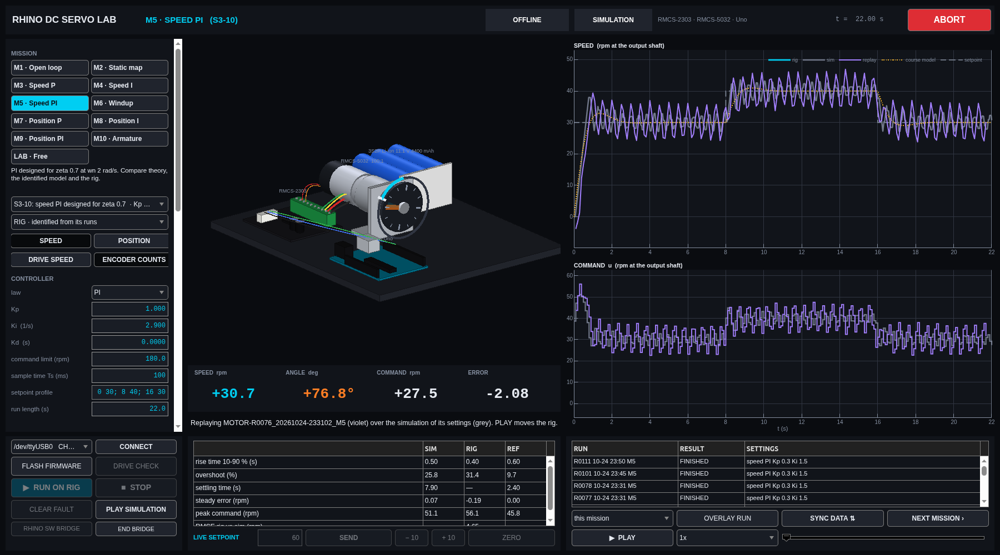
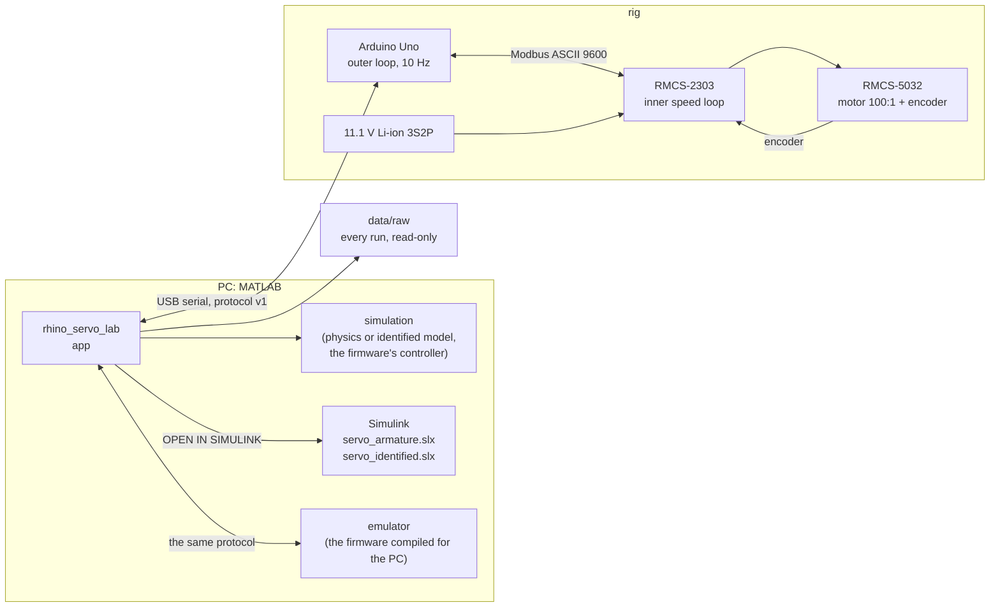

# Rhino DC servo lab: RMCS-2303 drive, RMCS-5032 encoder motor, Arduino Uno

**Speed and position control of the Rhino RMCS-5032 geared encoder motor on the RMCS-2303
Modbus servo drive, from an Arduino Uno: firmware, a MATLAB lab app, two Simulink models and
every measurement from the real rig.**

[](https://github.com/Samarth030312/rhino-rmcs-2303-dc-servo-control/actions/workflows/ci.yml)


A 12 V DC motor with a 100:1 planetary gearbox and a quadrature encoder sits behind the
RMCS-2303, a small servo drive that already closes its own speed loop. An Arduino Uno talks
to the drive over Modbus and closes the **outer** loop: P, I and PI control of speed and of
position, ten times a second. A MATLAB app simulates every experiment from the motor's
physics and from a model identified on the rig, runs the same experiment on the rig, records
it, and draws one on top of the other.

If you own this motor and drive, this repository gets you from the box to a measured,
modelled control loop. If you do not, the simulator and the Simulink models teach the same
control concepts without hardware.

<p align="center">
  
  <br><sub>A textbook PI design (ζ 0.7) on the rig: 31 % overshoot and a ±6 rpm limit cycle that
  the textbook did not predict and the identified model did (grey). From <code>data/raw</code> by
  <code>matlab/scripts/motor_session_report.m</code>.</sub>
</p>

## Get it running

Paste this into the MATLAB Command Window, on Windows, macOS or Linux (MATLAB R2023b or newer):

```matlab
gitclone("https://github.com/Samarth030312/rhino-rmcs-2303-dc-servo-control.git", Depth=1); cd rhino-rmcs-2303-dc-servo-control; setup open
```

It downloads the repository, checks the computer, installs the project's own Arduino
toolchain the first time (about 60 MB, hash-checked, no admin rights), and opens the app. The
simulator needs only MATLAB. A one-line installer for a terminal instead, the CH340 USB
driver and everything else per system: **[install](install/README.md)**. Then, step by
step: **[the sequence](docs/SEQUENCE.md)**.

## What the rig showed

From 112 recorded runs on three days, 2026-10-11, -23 and -24 ([analysis](results/reports/dc_motor/2026-10-24/ANALYSIS.md); 81 more on 2026-10-25, [analysis](results/reports/dc_motor/2026-10-25/ANALYSIS.md)):

- **The drive turns the motor into a near-perfect speed source.** Commanded against measured
  speed has a slope of 0.997 with no dead zone down to 2 rpm, in both directions.
- **A step is the drive's ramp, not a time constant.** The speed rises at a fixed 53 rpm/s.
  A model made of that ramp, the 70 ms Modbus latency and the 100 ms sampling predicts runs
  it never saw: median error 5.5 % of the setpoint over 83 runs. Refitted 13 days later, it
  had not moved (gain 1.002, ramp 53.9 rpm/s).
- **The delay decides the controller.** The textbook ζ 0.7 PI design overshoots 32 % (±0.5
  over three repeats) and limit-cycles; the identified model predicts both. Position P at
  Kp 1.0 sits on the edge of stability, and from its oscillation the position loop's real
  latency was measured: 0.11 s, not the 0.135 s estimated on paper.
- **Clamping anti-windup works.** With the command limited to 50 rpm, the loop recovers in
  0.5 s when the setpoint drops; the same model with a plain integrator does not recover in 6 s.
- **The drive had a dangerous habit, now fixed in firmware.** A speed run started from rest
  without re-homing the drive ran the motor backwards at full voltage, 12 times out of 12.
  With a HOME at every start: 0 of 21. The runaway guard caught every case within 0.2 s.
- **The datasheet holds.** At full voltage the motor ran at a median 166.8 rpm; the physics
  built from the datasheet and the 11.1 V battery predicts 166.5 rpm.

## Start here

| I want to … | Go to |
|---|---|
| understand how the simulator, Simulink, the emulator and the rig fit together | [how it works](docs/HOW_IT_WORKS.md) |
| run everything, in order | [the sequence](docs/SEQUENCE.md) |
| install it on Windows, macOS or Linux | [install](install/README.md) |
| use the app, no hardware needed | [the app guide](docs/guide/README.md) |
| run the Simulink models | [Simulink](docs/SIMULINK.md) |
| build and wire the rig | [replicate the rig](docs/REPLICATE.md) and [wiring](docs/hardware/WIRING.md) |
| understand the physics and the model | [first principles](docs/FIRST_PRINCIPLES.md) |
| use the official Rhino software with this setup | [Rhino software and the bridge](docs/RHINO_SOFTWARE.md) |
| read the results | [results](docs/RESULTS.md) and [the session reports](results/reports/dc_motor/) |
| use the data | [data](data/README.md) |
| fix a problem | [troubleshooting](docs/TROUBLESHOOTING.md) |
| follow the ENR312 course (Ahmedabad University) | [course guide](docs/course/README.md) |
| see what comes next | [roadmap](ROADMAP.md) |

<p align="center"></p>

## How it fits together



The controller law is the same line by line in the firmware (`pidStep` in C) and in MATLAB
(`servolab.motor.pidStep`), with the same clamping anti-windup. Details:
[architecture](docs/architecture/MATLAB.md), [serial protocol](docs/architecture/SERIAL_PROTOCOL.md).

## Status

- **On the rig:** every course experiment (open loop, static map, speed P / I / PI, windup,
  position P / I / PI), 193 runs on four days. Release acceptance on 2026-10-25 with the final
  firmware `886b32c`: every experiment of M1-M9, 27 of 27 runs without a fault
  ([report](results/reports/dc_motor/2026-10-25/REPORT.md)).
- **Fixed and verified on the rig:** the reverse runaway at start (HOME at every RUN); the soft
  stop at the end of a run (the motor ramps to rest before power goes off: no jolt); the bridge
  to the drive (registers read through it equal DRIVE CHECK's).
- **Not yet run:** the Rhino configuration software itself through the bridge (needs a Windows
  PC with the rig; [procedure](docs/RHINO_SOFTWARE.md)).
- **Tested on:** Ubuntu 22.04 with the rig; Windows, macOS and Ubuntu in CI (install,
  firmware compile, every MATLAB test, the app against the emulated drive). A real USB board
  is the one thing CI cannot plug in.

## Repository layout

```
setup.m      one command: path, checks, toolchain, the app (setup open)
firmware/    the Arduino sketch, and the same sketch compiled for the PC against an emulated drive
matlab/      app, physics, identified model, controller, metrics, Simulink models, tests
data/        every rig run: raw CSV (read-only), metadata JSON, RUN_REGISTER.csv
results/     one report per rig session, the analysis, figures, logs
docs/        how it works, physics, hardware, guide, course guide, knowledge base
install/     one-line set-up for Windows, macOS, Linux
```

## Related

Same lab family, same app design: [Arduino temperature control lab](https://github.com/Samarth030312/arduino-temperature-control-lab) ·
[Arduino water level control lab](https://github.com/Samarth030312/arduino-water-level-control-lab) ·
[STEVAL-EDUKIT01 rotary inverted pendulum](https://github.com/Samarth030312/steval-edukit).

## License

MIT ([`LICENSE`](LICENSE)). Arduino libraries are installed at pinned versions, not
redistributed ([`THIRD_PARTY.md`](THIRD_PARTY.md)). The Rhino manuals and software, and the
course handouts, are cited, not redistributed ([sources](docs/knowledge-base/SOURCE_REGISTER.csv)).
