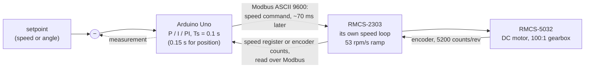
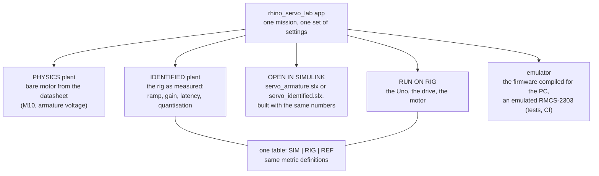

# How it works

Four things can run the same experiment: the **simulator** in the app, the **Simulink**
models, the **emulator** (the real firmware compiled for the PC), and the **rig**. This page
says what each one is, what it is for, and why they agree.

## The rig, and the one thing to understand first



The RMCS-2303 is a servo drive, not an H-bridge. It reads the encoder and closes its **own**
speed loop; there is no way to give the motor a raw voltage through it. Everything the
Arduino does is therefore an **outer** loop around a speed-controlled motor, and it runs only
as fast as 9600-baud Modbus allows: one sample every 100 ms, the command arriving about 70 ms
after the measurement it was computed from. That is why:

- P alone on **speed** leaves an error of r / (1 + Kp): the outer plant is a gain of about 1;
- P alone on **position** reaches the target: the drive's speed integrates to angle;
- a PI designed without the delay overshoots and limit-cycles on the rig.

Measured details: [results](RESULTS.md). The decision record: ED-M1 in
[engineering decisions](knowledge-base/ENGINEERING_DECISIONS.md).

## Four ways to run one experiment



| | What it is | Use it to |
|---|---|---|
| **Simulator** | MATLAB, inside the app. The controller is `servolab.motor.pidStep`, line for line the firmware's `pidStep` (clamping anti-windup included). The plant is either the physics of the bare motor (from the datasheet values in the physics panel) or the model identified from the rig's own runs. | learn the concepts without hardware; predict a rig run before making it |
| **Simulink** | Two generated models in `matlab/models/dc_motor`: the armature (voltage → current → torque → speed) and the identified rig (sampled PID, Modbus latency, drive ramp, quantised sensors). **OPEN IN SIMULINK** builds the model with the app's current settings and opens it. | see the block diagram; change blocks; answer Simulink assignments ([Simulink](SIMULINK.md)) |
| **Emulator** | The real sketch (`firmware/motor_controller`) compiled with g++ against an emulated RMCS-2303 that speaks Modbus. It runs in real time on a pseudo-terminal, so the app connects to it as if it were a board. | test the firmware and the app together without a rig (CI does this on every change) |
| **Rig** | The Uno, the drive, the motor and the battery. | measure |

The simulator and Simulink agree exactly at the controller samples
(`matlab/tests/test_motor_identified.m`, and [the analysis](../results/reports/dc_motor/2026-10-24/ANALYSIS.md), section 6).
The emulator runs the firmware's own C code. So a difference between the grey and the
coloured line in the app is a difference between the **model** and the **rig**, never between
two implementations.

## A run, from button to file

```mermaid
sequenceDiagram
    participant App as app (MATLAB)
    participant Uno as Arduino Uno
    participant Drv as RMCS-2303
    App->>Uno: $CFG (loop, law, gains, Ts, limit)
    App->>Uno: $SET setpoint, $RUN
    Uno->>Drv: LPR = 13, HOME, settle 150 ms, speed 0, mode CW
    loop every Ts
        Uno->>Drv: read speed register (or encoder counts)
        Uno->>Uno: e = r − y;  u = PID(e), clamped to ±uMax
        Uno->>Drv: direction + speed command
        Uno-->>App: $TEL seq, t, setpoint, measurement, error, u, counts, flags
        App-->>Uno: $PING (watchdog: silence > 1 s cuts motor power)
    end
    App->>Uno: $STOP (soft: ramp to rest, then power off)
    App->>App: save data/raw/dc_motor/MOTOR-Rnnnn_….csv (read-only),<br/>metadata JSON, RUN_REGISTER.csv, a picture of the window
```

Safety in the firmware, independent of the PC: the host watchdog (1 s), the runaway guard
(wrong direction or far too fast for two samples → motor power off), motor power off on any
lost Modbus reply, never the drive's "hold" mode, and the STOP button on D4. Protocol:
[serial protocol](architecture/SERIAL_PROTOCOL.md).

## Where the numbers come from

| Number | Source | Status |
|---|---|---|
| R, Kt, Ke, b, τm of the bare motor | the RMCS-5032 datasheet ([first principles](FIRST_PRINCIPLES.md)) | ESTIMATED from the datasheet |
| gain 1.000, ramp 53.4 rpm/s | fitted to the rig's open-loop steps (2026-10-11), confirmed 2026-10-24 (1.002, 53.9) | MEASURED |
| latency 70 ms (speed), 110 ms (position) | firmware loop timing on the rig; position fitted to its own oscillation | MEASURED |
| 4.6 rpm speed-register step, 0.115 rpm encoder step at 0.1 s | drive register; 5200 counts per output revolution | MEASURED / derived |
| battery 9.0–12.6 V, 8.8 A | Pro-Range 3S2P pack | seller specification |

Every value carries a status from [the vocabulary](knowledge-base/INDEX.md) in
`servolab.motor.params`; a MEASURED value names the session log it came from.
