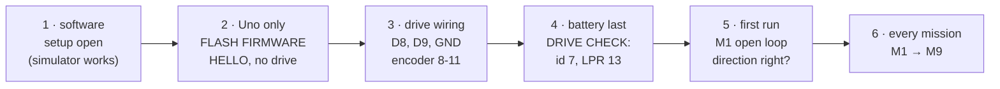

# Replicate the rig: from an empty bench to a measured control loop

## Bill of materials

| Part | What the lab uses | Notes |
|---|---|---|
| Motor | Rhino **RMCS-5032**: 12 V planetary gear motor, 100:1, quadrature Hall encoder 13 lines (5200 counts per output revolution), 180 rpm no-load at 12 V, Ø32 mm gearbox, Ø6 mm shaft | Robokits sells it as the "200 RPM" planetary encoder DC servo; its own table says 180 rpm (conflict C-M2, [hardware reference](hardware/HARDWARE_REFERENCE.md)) |
| Drive | Rhino **RMCS-2303** DC servo drive: 10–30 V, Modbus ASCII over UART at 9600 baud, slave id 1–7, its own speed and position loops, 67 × 56 × 13 mm | Supplied with the motor. The lab's board is black |
| Controller | **Arduino Uno** (a clone with a CH340C USB chip works; Windows needs the CH340 driver, see [install](../install/README.md)) | |
| Battery | **Pro-Range INR18650 Li-ion 3S2P**: 11.1 V nominal, 12.6 V full, 4400 mAh, 2C, built-in BMS | Any 11–13 V source that can give 4 A works; not 24 V |
| Protection | 5 A slow-blow fuse in the battery + lead, at the battery; a reachable connector or switch | The battery connector is the emergency stop |
| Wires | 0.75 mm² for power (battery → drive 16/17, drive 14/15 → motor), jumpers < 30 cm for D8, D9, GND | |
| Optional | a push-button D4 → GND (hardware STOP); a disc or pointer on the shaft to see the angle | |
| PC | Windows 10/11, macOS 11+ or Linux, MATLAB R2023b or newer (Simulink optional) | |

## Build, in this order

1. **Software first.** `setup open` in MATLAB (see [the sequence](SEQUENCE.md)). Play a few
   simulations: if something looks wrong on the rig later, you will know what it should look like.
2. **The Uno alone.** USB only, nothing else connected. **FLASH FIRMWARE**, then **CONNECT**:
   the top bar shows the firmware revision and "no drive". That proves the PC side.
3. **Wire the drive, battery unplugged.** Follow [wiring](hardware/WIRING.md) **by pin number on
   the drive's silkscreen**, not by wire colour: the lab's cable used neither of the two colour
   schemes in the documents. Uno D9 → drive pin 2 (RXD), D8 ← pin 3 (TXD), GND → pin 1.
4. **Battery last.** Plug it in through the fuse, then **DRIVE CHECK**: the drive answers
   (the lab's at slave id 7) and LPR reads 13 (the firmware writes 13 before every run; the
   drive's own default of 334 makes every speed 25.7 times wrong).
5. **First run: M1, open loop, direction.** A positive command must give a positive speed. If
   the firmware stops the motor with `runaway: wrong way`, swap **one** pair: the two motor
   leads at 14/15, or encoder A/B at 10/11. Never both. The runaway guard cuts motor power
   within 0.2 s; it exists because exactly this happened on 2026-10-11
   ([incident](safety/INCIDENT_2026-10-11.md)).
6. **Every mission.** M1 to M9, in order ([the sequence](SEQUENCE.md)). Each rig run is saved,
   registered and drawn over the simulation of its own settings.

Before any run with the battery: the [session checklist](safety/EXPERIMENT_CHECKLIST.md).

## What should match, and what probably will not

| You should see | Because | If not |
|---|---|---|
| open loop: speed = command (slope ≈ 1), a 53 rpm/s ramp | the drive's speed loop and its acceleration register | LPR not 13; battery below 10 V; another drive firmware |
| the model within a few rpm of the rig | the identified model is the lab rig's | your drive's acceleration register differs: identify your rig (**IDENTIFY FROM SELECTED RUN**) |
| P on position ends within a few counts | the drive integrates speed to angle | mechanical load or backlash on your shaft |
| free speed ≈ 180 × V / 12 rpm | the datasheet | a weak battery; a different gear ratio |

A different motor from the same family (another gear ratio or speed) works: enter its
datasheet values in the physics panel, set its lines per rotation in the firmware
(`LPR_RMCS5032`, `GEAR`, `CPR_OUT`), and identify it from its own open-loop runs.
