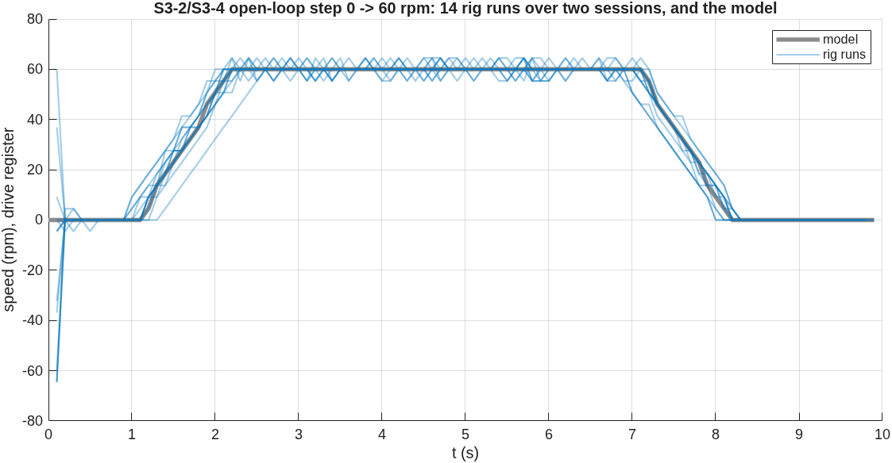
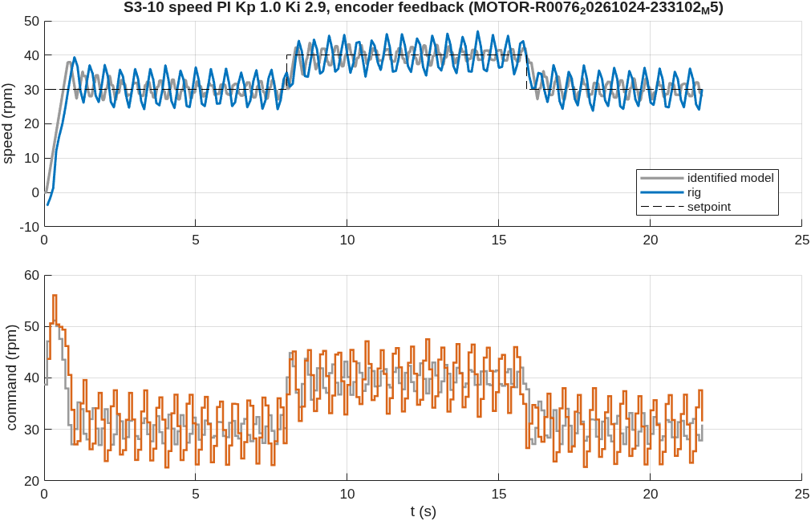
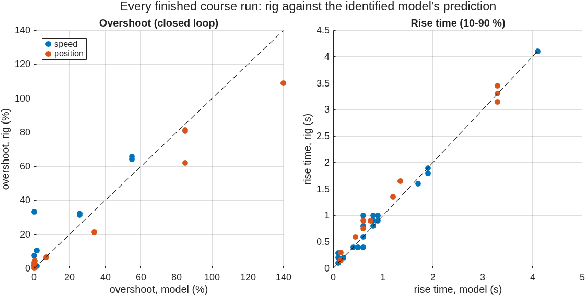
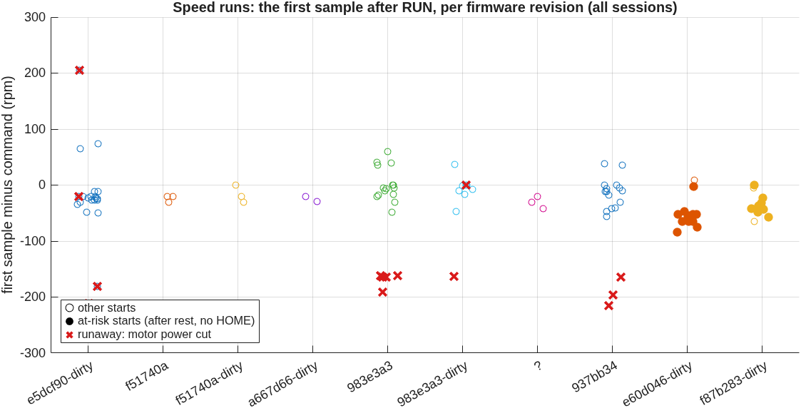

# Results

Everything below comes from `data/raw/dc_motor` through two scripts, rerun on every change:
`matlab/scripts/motor_session_report.m` (one session: every course question, rig against
model) and `matlab/scripts/motor_rig_analysis.m` (all sessions: accuracy, repeatability,
refit, Simulink). Full reports: [2026-10-23](../results/reports/dc_motor/2026-10-23/REPORT.md) ·
[2026-10-24](../results/reports/dc_motor/2026-10-24/REPORT.md) ·
[analysis of both](../results/reports/dc_motor/2026-10-24/ANALYSIS.md).
Grey in every figure is the identified model running the run's own settings. It was fitted
on 2026-10-11 data only, so every comparison below is a **prediction**.

## The plant

| | Rig | Model or theory | |
|---|---|---|---|
| static map, slope | 0.997 (forward), 0.998 (reverse) | 1 | [figure](../results/reports/dc_motor/2026-10-24/S3-3_static_map.png) |
| dead zone | none down to 2 rpm | — | |
| open-loop step 0 → 60 rpm, rise 10–90 % | 0.94 ± 0.06 s (14 runs) | 0.80 s | [figure](../results/reports/dc_motor/2026-10-24/S3-4_open_loop.png) |
| step shape | a 48–54 rpm/s ramp | ramp 53.4 rpm/s | |
| refit 13 days later | gain 1.002, ramp 53.9 rpm/s, fit error 1.99 rpm | gain 1.000, ramp 53.4 | |
| full-voltage speed (runaways) | median 166.8 rpm (14 runs) | 166.5 rpm (datasheet, 11.1 V) | |
| command latency | 70.5 ms (speed), 74.8 ms (encoder), 78 ms (position), from the firmware's clock | position fitted: 0.11 s | |

## Closed loop

| Course question | Rig | Model | Textbook |
|---|---|---|---|
| speed P, e_ss at 60 rpm, Kp 0.2 / 0.5 / 0.8 | 49.98 / 40.29 / 33.40 rpm | r/(1+Kp): 50 / 40 / 33.3 | same |
| speed I, overshoot at Ki 0.5 / 1 / 2 / 4 | 1.5 / 2.7 / 3.5 / 64 % | 0 / 0 / 0 / 55 % | 0.9 / 10 / 24 / 38 % (τ = 0.72 s) |
| speed PI for ζ 0.7 (Kp 1.0, Ki 2.9), first overshoot | **32.0 ± 0.5 %** (3 runs), then a ±6 rpm limit cycle | 26 %, the same cycle | 4.6 % |
| windup: recovery after saturation at 50 rpm | 0.5 s (clamping) | 0.5 s; plain integrator: > 6 s | |
| position P, 10° moves, final error Kp 0.1 / 0.3 / 1.0 | 0.18 / 0.06 / 0.40° | 0.09 / 0.01 / 0.04° | 0 (type 1) |
| position P Kp 1.0, overshoot | 73 ± 10 % (5 runs) | edge of stability: PM 26° | |

## How good the model is

Over 83 finished runs (2026-10-23 and 24): median error **5.5 % of the run's largest
setpoint**. Part of every speed error is quantisation (the drive register reads in 4.6 rpm
steps). Overshoot and rise time, rig against model:

## Safety

A speed run started from rest without re-homing the drive ran the motor backwards at full
voltage: **12 of 12** such starts over three days, every one stopped by the firmware's runaway
guard within 0.2 s. With a HOME at every RUN (firmware e60d046 and later): **0 of 21**. The
cause inside the drive is not known; the fix rests on the record, every start of every session
log ([analysis §1](../results/reports/dc_motor/2026-10-24/ANALYSIS.md)).

## Open

- The soft stop (no jolt when an experiment ends turning) and the bridge to the Rhino software
  are tested on the PC and against the emulated drive, not yet on the rig.
- The drive's current limit: 3 A (manual) or 5 A (product page), conflict C-M7.
- [All open items](knowledge-base/OPEN_ITEMS.md).
