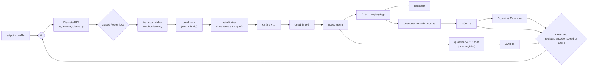

# Simulink models

Two models, generated from code (so they can be reviewed, diffed and rebuilt) in
`matlab/models/dc_motor/`. Both keep their parameters in the **model workspace**; nothing is
read from the base workspace, so a model always runs with the numbers it was given.

| Model | What it is | Built by | Run by |
|---|---|---|---|
| `servo_armature.slx` | the bare motor driven by armature voltage: current, torque, speed, angle, a load-torque step, PID on speed or angle | `build_dc_motor_simulink` | `run_dc_motor_simulink(cfg)` |
| `servo_identified.slx` | the rig as measured: the Arduino's sampled PID (clamping anti-windup), Modbus latency, the drive's ramp, gain, quantised speed register or encoder | `build_motor_identified_simulink` | `run_motor_identified_simulink(model, cfg, profile, Tend)` |

## From the app

**OPEN IN SIMULINK** builds the model that matches the plant menu (armature, or identified)
with every current setting (gains, Ts, limit, latency, feedback path, setpoint profile, load)
and opens it. Run it with the green Run button; the scopes show the same signals the app plots.
Change blocks freely: rebuild with the button to get back to the app's version.

## From a script

```matlab
setup
m = servolab.motor.rigModel();                                  % the identified rig
c = servolab.motor.defaultConfig('rig', 'speed');               % Ts 0.1 s, latency 0.07 s
c.ctrl = 'PI'; c.Kp = 1.0; c.Ki = 2.9; c.spdFb = 'encoder';
profile = [0 30; 8 40; 16 30];                                  % [t (s), setpoint (rpm)]
K = run_motor_identified_simulink(m, c, profile, 22);           % Simulink
S = servolab.motor.identifiedSim(m, c, profile, 22);            % the same model in MATLAB
plot(K.tk, K.measK, S.tk, S.meas, '--'); legend('Simulink', 'MATLAB')
```

The two agree exactly at the controller samples (`matlab/tests/test_motor_identified.m`; and
section 6 of [the analysis](../results/reports/dc_motor/2026-10-24/ANALYSIS.md), which also scores both against the rig).

## The identified model, block by block



## Course assignments

For the ENR312 Simulink assignment on the motor (Assignment 3) and the MOTOR handout's
Simulink questions (S3-7, S3-8), the [course guide](course/README.md) lists which model and
which mission answer which question. The identified model was built for S3-7: it predicted 14
hardware runs it was never fitted to.
