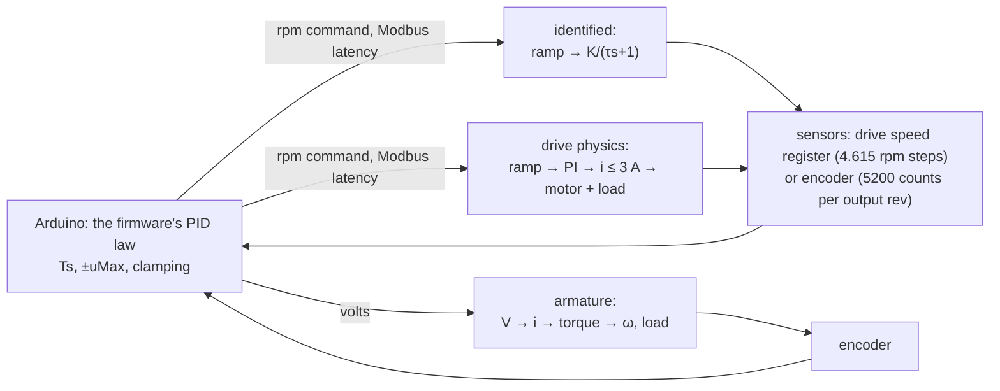
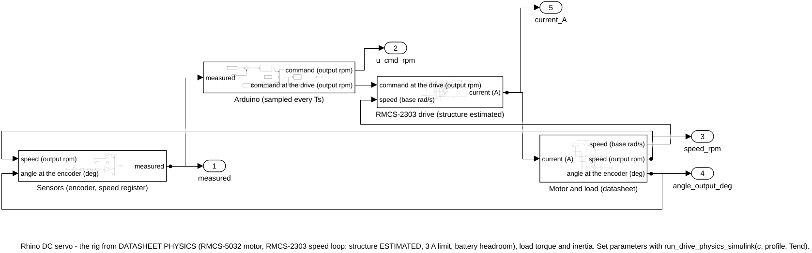
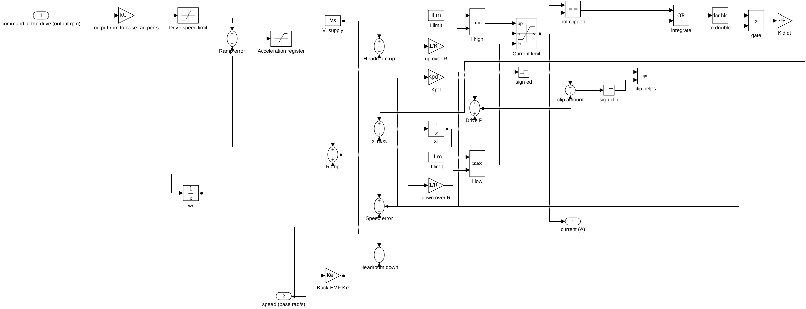
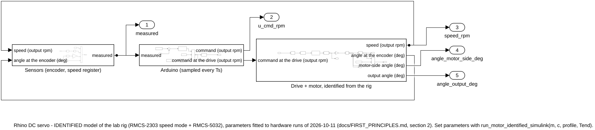
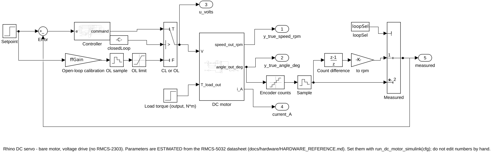

# Simulink models

Three models in `matlab/models/dc_motor/`, one for each plant the app can simulate. Each is
generated from code (`build_*.m`), so it can be reviewed, diffed and rebuilt, and each computes
what the MATLAB simulator of the same plant computes, to rounding (see
[Verification](#verification)). Simulink is optional: the app and every script run without it.

| Model | Plant in the app | What it is | Built by | Run by |
|---|---|---|---|---|
| `servo_identified.slx` | RIG · identified from its runs | the rig as the Arduino sees it, fitted to measured steps | `build_motor_identified_simulink` | `run_motor_identified_simulink` |
| `servo_drive_physics.slx` | RIG · drive + motor physics | the rig built from the motor's datasheet and an estimated drive loop | `build_drive_physics_simulink` | `run_drive_physics_simulink` |
| `servo_armature.slx` | MOTOR · armature voltage | the bare motor driven by a voltage, no drive | `build_dc_motor_simulink` | `run_dc_motor_simulink` |

`servolab.motor.runSimulink(c)` picks the model from the config's plant; it is the one call to
remember.

## Why three models

The RMCS-2303 closes its own speed loop, and its internals are not published. That splits
"what does the motor do?" into three questions, one model each.

**1. What will the rig do with this controller? `servo_identified`.** Seen from the Arduino,
the drive and motor behave like a speed source: the command passes through the drive's
acceleration ramp (53.4 output rpm/s) to a speed with unit gain (K = 1.000) and no lag
measurable at the 100 ms sampling. These numbers were fitted to four open-loop runs of
2026-10-11 (`servolab.motor.rigModel`, [first principles §2](FIRST_PRINCIPLES.md)). The model
adds what the Arduino adds: its PID law, the Modbus latency (70 ms for speed, 110 ms for
position, both measured) and the quantised measurements. It predicts runs it was not fitted
to within a median 4.6-5.5 % of the setpoint over 169 runs ([results](RESULTS.md)). It has no
current, no torque and no load: the identification had none to fit.

**2. What happens under a load, with more inertia, or on a flat battery?
`servo_drive_physics`.** The same Arduino around a physical plant: the motor from its datasheet
(R, Ke = Kt, b, J, derived in `servolab.motor.physics`), the drive as ramp → PI speed loop →
current clipped at 3 A and at the battery's headroom (V_supply − Ke ω)/R, and a load torque at
the output shaft. The drive-loop structure and its bandwidth (40 rad/s) are **ESTIMATED**: the
manual does not give them. Checked: the free speed it predicts at 11.1 V, 166.5 rpm, against
the rig's full-voltage runaways, median 166.8 rpm. Use it for what the identified model cannot
show; where both apply, the identified model is the one measured.

**3. How does a DC motor behave without a servo drive? `servo_armature`.** The textbook model,
L di/dt = V − R i − Ke ω and J dω/dt = Kt i − b ω − T_load/(N η), with the controller writing a
voltage (at most the battery's) and the encoder as feedback. This is what the drive does
internally; the rig itself cannot be driven by voltage. Mission M10 in the app.



## The blocks

The two rig models share their Arduino and sensor parts (`simulink_servo_io.m`); only the plant
differs.



- **Arduino (sampled every Ts)**: setpoint profile, error, *Arduino PID*, the open-loop path,
  and the Modbus latency as an exact delay of `nLat` 1 ms steps.
- **Arduino PID** (`simulink_arduino_pid.m`): the firmware's control law, built from primitive
  blocks. Per sample: D = 0 on the first sample, else (Tf D₋₁ + Kd (e − e₋₁)) / (Tf + Ts);
  I = I₋₁ + Ki Ts e; u = clip(Kp e + I + D, ±uMax). When u is clipped, the push is in the
  error's direction and Ki ≠ 0, the integrator advances only up to the limit and is never moved
  back against the error. Simulink's Discrete PID Controller block is not used: its "clamping"
  stops the integrator instead, which on the windup experiment (M6) differs by 1.8 %.
- **Sensors (encoder, speed register)**: the drive's speed register (steps of 4.615 output
  rpm) or encoder counts (5200 per output revolution), differenced over Ts for speed, all
  sampled every Ts.
- **The plant**: *Drive + motor, identified from the rig* (dead zone, acceleration limit,
  K/(τs+1), dead time, angle, backlash), or *RMCS-2303 drive (structure estimated)* followed by
  *Motor and load (datasheet)*:



The identified model, and the armature model:





Every parameter lives in the **model workspace** and is set by the run functions from a config,
so a model never picks up a base-workspace variable of the same name.

| Variable | Meaning | Models |
|---|---|---|
| `Ts`, `nLat`, `uMax` | controller sample time (s), Modbus latency (1 ms steps), command limit | rig models |
| `Kp`, `Ki`, `Kd`, `Tf`, `aw`, `KiOn` | PID gains, derivative filter (s), anti-windup on/off, Ki ≠ 0 | all |
| `spProfile`, `olProfile` | setpoint and open-loop command, `[t, value]` rows, held | rig models |
| `closedLoop`, `measSel` | closed or open loop; drive register, encoder speed or angle | rig models |
| `qSpd`, `qCnt` | quantisation of the speed register and of the encoder | rig models |
| `K`, `aTF`, `acc`, `nTheta`, `dz`, `blWidth` | identified gain, lag, ramp, dead time, dead zone, backlash | identified |
| `kU`, `wMax`, `accDt`, `Kpd`, `KidDt`, `Ilim`, `Vs` | drive: units, speed limit, ramp, speed-loop PI, current limit, battery | drive physics |
| `R`, `L`, `Ke`, `Kt`, `b`, `J` or `Jt`, `N`, `eta` | motor and gearbox | drive physics, armature |
| `TLbase` or `dist`, `tDist` | load torque step | drive physics, armature |

Solvers: the rig models use a fixed 1 ms step, the same explicit step as their MATLAB loops;
the armature model uses ode45 (max step 1 ms), and its MATLAB twin the exact discretisation of
the same linear equations.

## Running any experiment

**From the app.** Choose a mission, a preset and the plant (PLANT menu), then **OPEN IN
SIMULINK**: the matching model opens with every current setting (gains, Ts, limit, latency,
feedback path, setpoint profile, load). Press Run in Simulink: a scope opens with the setpoint
against the measurement and the command (and, in the two physics models, the motor current).
Edit blocks freely; `build_*` restores the generated version.

**From a script.** Every preset of every mission is in `servolab.motor.presets`:

```matlab
setup
L = servolab.motor.presets('M5');                 % the presets of mission M5, as in the app
c = servolab.motor.specConfig(L(1).spec);         % PI designed for zeta 0.7, identified rig
R = servolab.motor.runSimulink(c);                % Simulink
S = servolab.motor.simulatePlant(c);              % the same in MATLAB
plot(S.tk, S.meas, R.tk, R.meas, '--'); legend('MATLAB', 'Simulink')

c.plantKey = 'rigPhys';                            % the same experiment on the drive physics
c.dist = 0.5; c.tDist = 10;                        % with a 0.5 N*m load from 10 s
R2 = servolab.motor.runSimulink(c);

c.profile = [0 20; 5 60; 10 -40]; c.Tend = 15;     % any setpoint profile, [t (s), value]
R3 = servolab.motor.runSimulink(c);
```

A hardware experiment with several runs (a gain sweep) is one preset per run; its "all runs"
entry in the app plays them in order. `matlab/scripts/motor_simulate_all.m` runs every preset,
and every rig experiment on the drive physics too, in both, and writes
[`results/tables/simulation_all_presets.csv`](../results/tables/simulation_all_presets.csv)
(71 runs, no error).

## Verification

`matlab/tests/test_simulink_crosscheck.m` runs the same 71 cases in the MATLAB simulator and in
the Simulink model of the plant, and compares the measured signal and the command at every
controller sample. Largest difference of the measured signal, 2026-10-25:

| Plant | Cases | Quantisation off, relative | As simulated, absolute (rpm or deg) |
|---|---:|---:|---:|
| identified rig | 32 | 7.5e-11 | 6e-14 |
| drive physics | 33 | 1.0e-10 | 3e-14 |
| armature | 6 | 1.1e-12 | 2e-12 |

The test requires 1e-8 without quantisation. Reaching rounding level took four corrections,
each a real difference between the two implementations: the angle integrator now updates with
the new speed, as the MATLAB loop does; the delays are exact integer-sample delays instead of
interpolating Transport Delay blocks; the controller is the firmware's law instead of Simulink's
PID block; and logged outputs are read after the sample instant, not at it. Against the rig,
both are scored in section 6 of each [analysis](../results/reports/dc_motor/2026-10-25/ANALYSIS.md).
