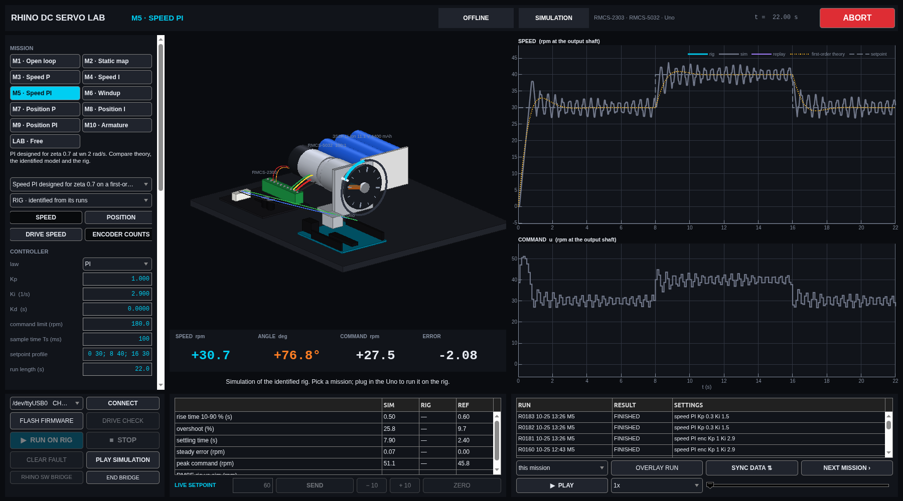
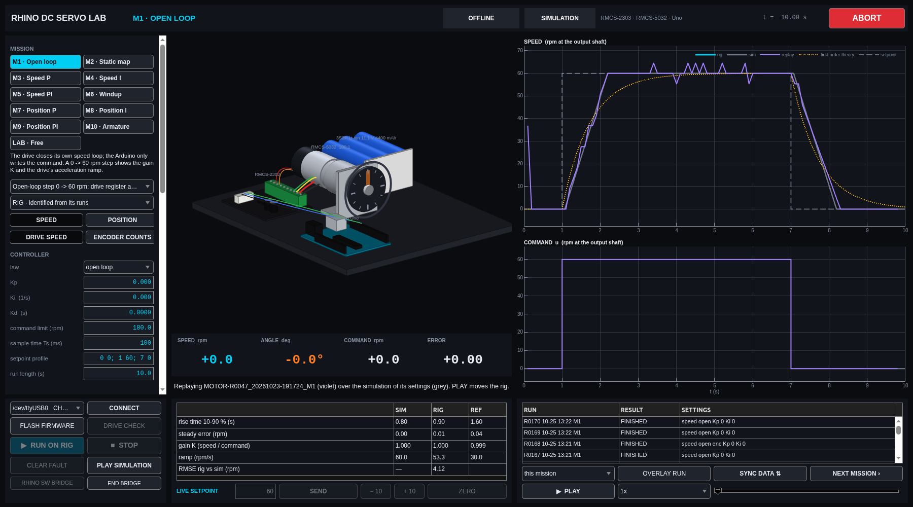
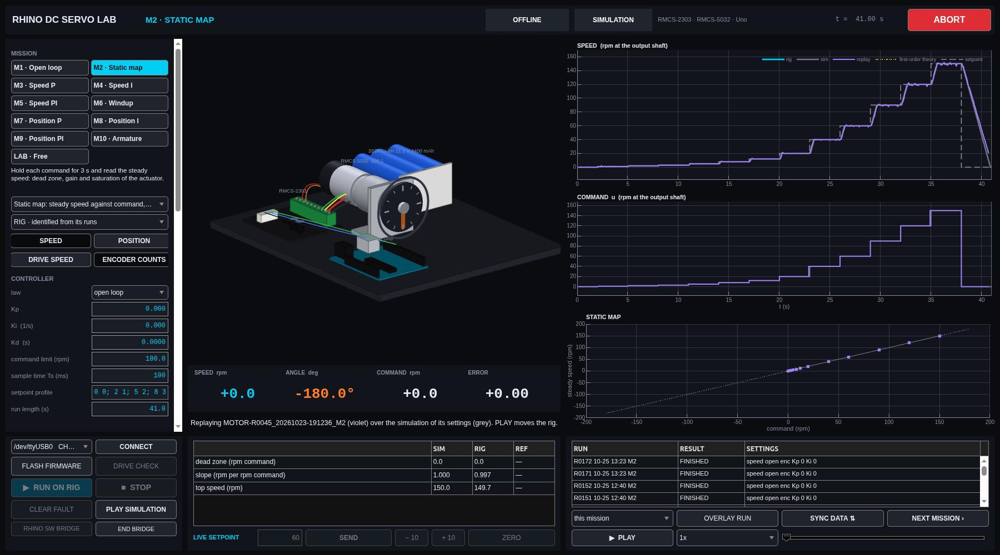
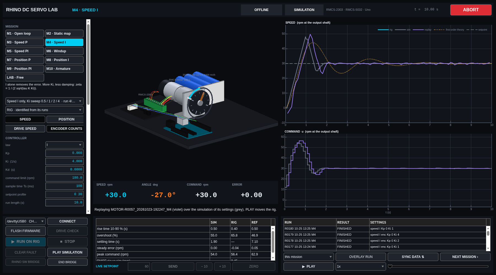
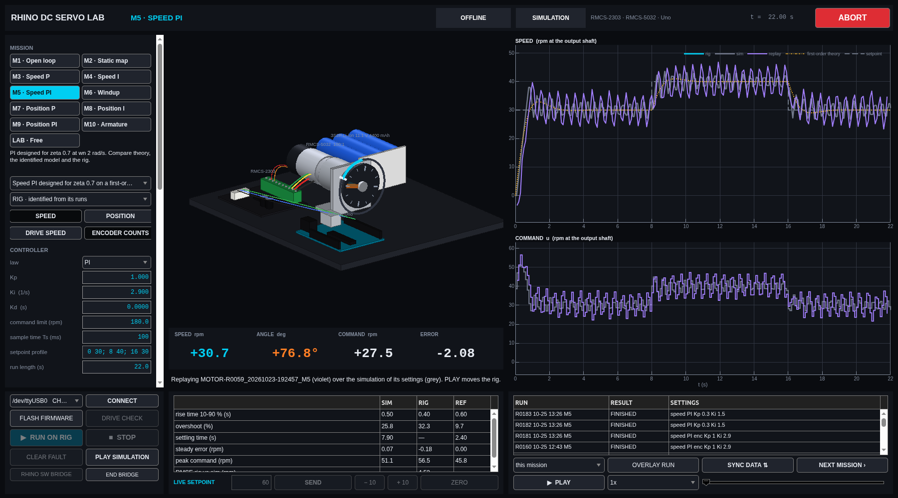
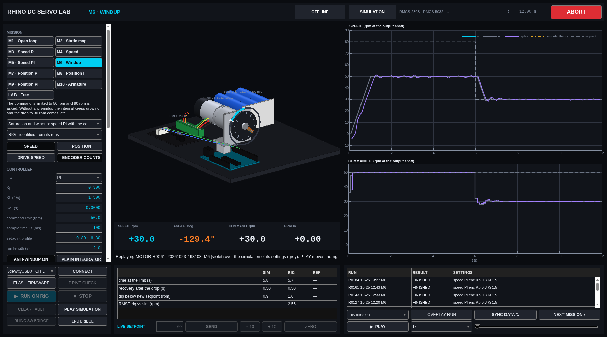
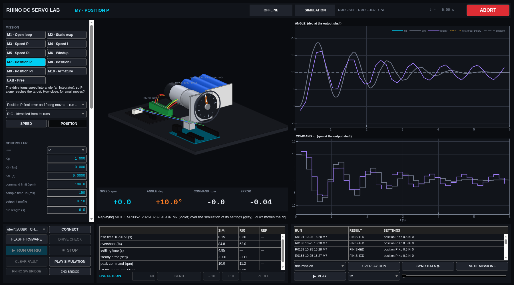

# The mission-control guide

A practical guide to `rhino_servo_lab`, the one window in which you simulate, run and replay
every experiment of this rig. If you know what a transfer function is, or are about to learn,
this is enough to work through outer-loop speed and position control from open loop to PI.
Every experiment, with its settings and what the model predicts, is listed in
[experiments](../EXPERIMENTS.md); the measured answers are in [results](../RESULTS.md).

**Contents**

1. [What it is, and what it is not](#1-what-it-is-and-what-it-is-not)
2. [Start in two minutes](#2-start-in-two-minutes)
3. [A tour of the screen](#3-a-tour-of-the-screen)
4. [Your first simulation: M1](#4-your-first-simulation-m1)
5. [Reading the plots and the numbers](#5-reading-the-plots-and-the-numbers)
6. [The missions, one by one](#6-the-missions-one-by-one)
7. [Driving the rig](#7-driving-the-rig)
8. [Replay, identify, record](#8-replay-identify-record)
9. [Working with the data in MATLAB](#9-working-with-the-data-in-matlab)
10. [Questions and problems](#10-questions-and-problems)

---

## 1. What it is, and what it is not

The rig is a 12 V gear motor (RMCS-5032, 100:1, a 13-line encoder on the motor shaft) behind
a servo drive (RMCS-2303) that **closes its own speed loop**. An Arduino Uno talks to the drive
over Modbus at 9600 baud and closes the *outer* loop: open loop, P, I or PI,
on speed or on angle, ten times a second.

The app answers one question: *what will this controller do on this rig?* It answers it
honestly:

- **It runs the Arduino's loop, not a textbook loop.** The same PI law as the firmware
  (`pidStep`, with clamping anti-windup), sampled every 100 ms, the command landing 70 ms
  later (the Modbus write), the speed read the way the firmware reads it (the drive's register
  in 4.6 rpm steps, or encoder counts over Ts).
- **The plant is the rig itself.** The model was identified from the rig's own open-loop
  steps: gain 1.000, an acceleration ramp of 53.4 rpm/s, nothing slower than the sampling can
  see. On runs it was never fitted to, it predicts the rig within a few rpm
  ([the 2026-10-23 report](../../results/reports/dc_motor/2026-10-23/REPORT.md)).
- **What it cannot know** is a change in your rig: another battery voltage, a load on the
  shaft, a drive with other settings. Section 8 shows how to re-identify it from one run.

Next to every simulated number is the same number from the rig (RIG) and from first-order
theory (REF: K 1, τ 0.72 s, no delay), so the three can be compared line by line.

## 2. Start in two minutes

New computer (Windows, macOS, Linux): paste the one line for your system from
[`install/`](../../install/README.md). It fetches the repository, checks the USB driver and
opens MATLAB on the app. After that, in MATLAB:

```matlab
cd ~/rhino-rmcs-2303-dc-servo-control     % where you cloned it
setup open          % checks the computer, then opens rhino_servo_lab
```

The window opens on **M5 · Speed PI** with a simulation already run. Nothing is connected
and nothing moves: the top bar says **OFFLINE** and **SIMULATION**.



## 3. A tour of the screen

**Top bar.** The mission, the link (OFFLINE or `RIG <port>`), the state (SIMULATION, READY,
RUNNING, STOPPED, FAULT), the firmware revision and drive id, ● REC while a rig run is being
recorded, the run clock, and **ABORT**. ABORT, Esc and Space cut motor power at once.

**Left: what you are simulating.**

- **MISSION:** M1-M9 one control question each, M10 the motor itself (physical model), LAB
  free use. The line under the buttons says what the mission is about.
- **Preset:** the runs of the mission's hardware experiments, so the simulation and the rig run
  exactly the same thing. "▶▶ all runs" plays a whole series on the rig.
- **SPEED / POSITION** and **DRIVE SPEED / ENCODER COUNTS:** which loop, and where the speed
  comes from. The drive's register is coarse (4.6 rpm steps) but fresh; encoder counts over
  100 ms are fine (0.115 rpm) but on average 50 ms old.
- **CONTROLLER:** law, Kp, Ki, the command limit, the sample time, the **setpoint profile**
  (time-value pairs, e.g. `0 30; 8 40; 16 30`) and the run length. Type and press Enter; the
  simulation reruns a quarter of a second after the last change.
- **RIG MODEL:** gain K, drive ramp, Modbus latency, lag tau. IDENTIFY and RESET in section 8.

**Centre: the rig in 3-D.** The output disc turns with the simulated, live or replayed angle;
the orange marker is the shaft. The **cyan ring** is the speed (a full ring = 180 rpm), the
**white tick** the speed setpoint, the **dashed radius** the angle setpoint in position missions,
and the pale wedge the last 80 ms of motion. Under it: speed, angle, command and error, and
one line saying what happened or what to do next.

**Right: only the two plots you need.** The controlled variable (speed or angle) and the
command u that the Arduino sends to the drive, with its limits. M2 adds the static map.

Colours, everywhere: **grey** simulation · **cyan** the live rig · **orange** the live command ·
**violet** a recorded run · **dotted amber** first-order theory · **dashed** the setpoint.

**Bottom.** Left: the rig controls (port, CONNECT, FLASH FIRMWARE, DRIVE CHECK, RUN ON RIG,
STOP, CLEAR FAULT, PLAY SIMULATION). Centre: the SIM / RIG / REF table and the LIVE SETPOINT
row, used while a rig run is going. Right: every recorded run of this mission (or of all), with
OVERLAY RUN, NEXT MISSION, PLAY and a scrub bar.

### Plants and the datasheet panel

**PLANT** chooses what is simulated:

- **RIG · identified:** the measured black box (gain, drive ramp, Modbus latency), the default.
- **RIG · drive + motor physics:** the drive's speed loop around the motor equations.
- **MOTOR · armature voltage:** the bare motor driven by a voltage, without the drive. This is
  the textbook motor: the command is in volts, the armature current gets its own plot, and the
  load torque and inertia factor under DISTURBANCE act on it (mission M10).

The **MOTOR · DRIVE · BATTERY** panel takes the datasheet values (rated voltage, no-load speed
and current, stall current, gear ratio, J, L, drive current limit, battery voltage and capacity)
and derives R, Kt = Ke, b, the electrical and mechanical time constants, the free speed and
ω(s)/V(s), shown live under the fields. **OPEN IN SIMULINK** opens the Simulink model of the
chosen plant with the current settings ([Simulink](../SIMULINK.md): three models, and why).

### Runs and data

Every rig run gets a number in `data/RUN_REGISTER.csv`, e.g. `MOTOR-R0062_20261024-101500_M5`
(apparatus, run number, time, mission), including runs the firmware stopped or you aborted.
**SYNC DATA** commits the new runs, logs and reports and pushes them to GitHub.

## 4. Your first simulation: M1

Click **M1 · Open loop** and press **PLAY SIMULATION**.



- **The speed** climbs in a straight line, not a curve: the drive limits the acceleration to
  about 53 rpm/s (its acceleration register, 5000). A 0 → 60 rpm step therefore takes about
  1.1 s, whatever a first-order "tau" would say.
- **The command** jumps to 60 at once: in open loop the Arduino just writes the setpoint.
- **The table:** rise 10-90 % 0.80 s in the model, **0.90 s on the rig**; slope 53.3 rpm/s
  measured against 53.4 fitted; gain 1.000. The amber first-order model (K 1, τ 0.72 s) has the
  same final value but the wrong shape: the rig is a ramp, not a lag.

## 5. Reading the plots and the numbers

**Time** starts at 0 when the run (or PLAY) starts. The rig's samples are 100 ms apart, so its
trace is a polyline; the simulation runs on a 1 ms grid and is sampled like the rig for the
table.

**The table** is computed by one function, `servolab.motor.stepMetrics`, for SIM, RIG and REF
alike, on the first step of the profile (the first setpoint change):

| Row | Meaning |
|---|---|
| rise time | 10 % to 90 % of the step |
| overshoot | the largest excursion past the setpoint, % of the step |
| settling time | from the step until the output stays within 2 % (or 1.5 feedback steps, whichever is larger); "—" means it never does, e.g. a limit cycle |
| steady error | setpoint minus the mean of the last 20 % of the step |
| peak command | the largest \|u\| |
| RMSE rig vs sim | the rig against the simulation of the same settings, over the whole run |
| P theory | r / (1 + K Kp), the steady error a pure P loop must leave (M3) |
| dead zone, slope, top speed | from the static map (M2) |
| time at the limit, recovery, dip | the windup test (M6): recovery is the time from the setpoint drop until the speed first comes within 5 % of the new setpoint |

## 6. The missions, one by one

Rig numbers below are from the session of 2026-10-23
([report](../../results/reports/dc_motor/2026-10-23/REPORT.md)); every session is in [results](../RESULTS.md).

### M1 · Open loop
*How does the actuator respond to a step?* See section 4. Compare DRIVE SPEED and ENCODER
COUNTS: the register's 4.6 rpm staircase against the counts' fine but delayed reading.

### M2 · Static map
*Is there a dead zone, and where does it saturate?* Commands from 1 to 150 rpm, 3 s each, both
directions. **On the rig: no dead zone** (2 rpm asked, 2.04 measured), slope 0.997 forward and
0.998 reverse, linear up to 150 rpm. The drive closes its own loop, so the Arduino's
"actuator" is a near-perfect speed source up to the motor's free speed on the battery (about
166 rpm at 11.1 V).



### M3 · Speed P
*Why does P alone leave an error?* Around a speed source with gain 1, the loop gain is Kp, so
the error is r/(1 + Kp): 83 %, 67 %, 56 % of the step for Kp 0.2, 0.5, 0.8. Raise Kp towards 1
and the 100 ms sampling with the 70 ms latency makes the loop ring.

### M4 · Speed I
*More Ki, less damping.* The delay-free theory gives ζ = 1/(2√(τ K Ki)) and overshoots of
1 %, 10 %, 24 %, 38 % for Ki 0.5, 1, 2, 4. **The rig: 0 %, 3.1 %, 1.8 %, 65.8 %.** The model,
which knows the ramp and the latency, predicts 0, 0, 0 and 55 %. At low Ki the integrator is
slower than the drive's ramp, so nothing overshoots; at Ki 4 the latency adds the phase lag the
formula leaves out.



### M5 · Speed PI
*Does the textbook design work?* Kp 1.0, Ki 2.9, designed for ζ 0.7 at ωn 2 rad/s on the
first-order model, predicts 4.6 % overshoot (9.7 % with the PI zero, the amber REF column).
**The rig overshoots 32.3 %** and then holds a **±6.7 rpm limit cycle**; the identified model
predicted 25.8 % and shows the same cycle. A design for this rig has to include the delay, or
use a lower Kp (the hand-tuned Kp 0.3, Ki 1.5 settles).



### M6 · Windup
The command is limited to 50 rpm and 80 rpm is asked for 6 s; then 30 rpm. With the firmware's
clamping anti-windup, **the rig is back within 5 % of 30 rpm 0.5 s after the drop**, as the
model predicts. Switch to **PLAIN INTEGRATOR** (simulation only): the integral has grown for 6 s,
and the speed stays at 50 rpm for the rest of the run.



### M7 · Position P
*Does P alone reach a 10° target?* Yes: the drive turns a speed command into motion even at a
fraction of an rpm, so there is no dead zone to stop short in. **The rig ends within 0.11-0.17°**
(two encoder counts) for Kp 0.1, 0.3 and 1.0; Kp 1.0 overshoots 62 %.



### M8 · Position I and M9 · Position PI
Two integrators (the drive's speed-to-angle and the controller's) make I alone oscillate around
the target. PI adds overshoot and a slow tail; without a load on the shaft there is no offset
for the integrator to remove.

### M10 · Armature
*What is inside the drive's loop?* The bare RMCS-5032 driven by a voltage, built from the
datasheet values in the physics panel: speed and armature current, a PID of your own, a load
torque and extra inertia under DISTURBANCE. Simulation only; on the rig the drive closes this loop.

### LAB · Free
Any loop, any law, any profile. On the rig, LIVE SETPOINT changes the speed or the angle while
it runs.

## 7. Driving the rig

1. **Wire and power** per [wiring](../hardware/WIRING.md); the
   [session checklist](../safety/EXPERIMENT_CHECKLIST.md) first.
2. **Plug in the Uno.** The app notices it within a second and offers **Flash + connect** (first
   time on this board, or after a firmware update) or **Connect**. FLASH FIRMWARE does the same at
   any time; it installs the Arduino toolchain the first time (about 60 MB) and writes a log.
3. **DRIVE CHECK.** LPR must read 13; the loop time should read about 74.5 ms of 100.
4. **RUN ON RIG.** The run is drawn live (cyan, orange) over the simulation of the same settings
   (grey); the 3-D disc turns with the measured angle; the table fills a RIG LIVE column. When
   the run ends it is saved (raw CSV, read-only, plus metadata and a picture of the window) and
   appears under RUNS.
5. **Stopping.** STOP brings the motor to rest on the drive's ramp, then switches motor power off;
   ABORT, Esc and Space switch it off at once. The firmware also stops by itself
   if MATLAB is silent for 2 s, if the motor runs away (wrong way or too fast) or if the drive
   stops answering. The state chip turns red, the status line says why and what to check, and
   **CLEAR FAULT** (highlighted) re-homes the drive before the next run.

## 8. Replay, identify, record

- **Replay.** Pick a run under RUNS and press **OVERLAY RUN**. The app takes that run's own
  settings (loop, law, gains, profile), simulates them, draws the run in violet, and fills the
  RIG column and the RMSE. **PLAY** moves the 3-D rig through the recorded run; the scrub bar
  jumps to any instant.
- **Identify.** Pick an open-loop speed run (M1 or M2) and press **IDENTIFY FROM SELECTED RUN**:
  K, the ramp, tau and the dead time are fitted to it (`servolab.motor.fitIdentified`), and every
  mission is simulated with them. **RESET TO MEASURED MODEL** goes back.
- **Record.** `app.record(folder)` plays the current simulation or replay frame by frame into
  `simulation.mp4` with a `run_config.json`.

## 9. Working with the data in MATLAB

```matlab
I = servolab.motor.runIndex();                         % every rig run, newest first
R = servolab.motor.loadHardwareRun(I.id{1});           % R.T: t_s, setpoint, meas, err, u, pos_counts, ...
m = servolab.motor.stepMetrics(R.T.t_s, R.T.setpoint, R.T.meas, R.T.u, 'Resolution', 0.115);
S = servolab.motor.identifiedSim(servolab.motor.rigModel(), R.cfg, [0 30; 8 40; 16 30], 22);
motor_session_report('2026-10-23', '18:50')         % the whole session, with figures
```

## 10. Questions and problems

| Problem | What to do |
|---|---|
| No port in the list | Data cable, another USB socket; `setup` lists the ports and says what is missing (driver, permission, busy port). Windows: [install/windows](../../install/windows/README.md#no-com-port) |
| "Port open, but no reply from the firmware" | FLASH FIRMWARE |
| "NO DRIVE answered" | Battery on? D9 → drive pin 2, D8 ← pin 3, GND; then DRIVE CHECK |
| FAULT: runaway, wrong way | Encoder A/B or motor leads reversed (swap one pair); then CLEAR FAULT. If the wiring has not changed: see the open observation in the [2026-10-23 report](../../results/reports/dc_motor/2026-10-23/REPORT.md#safety-events) |
| FAULT: runaway, too fast | DRIVE CHECK: LPR must be 13 |
| FAULT: host silent | MATLAB was blocked for over 2 s (a modal dialog, heavy work); run again |
| Upload fails on Apple silicon ("bad CPU type") | `softwareupdate --install-rosetta --agree-to-license` |
| The table says "—" for settling | The output never stays within the band: look at the plot, it is probably a limit cycle |
