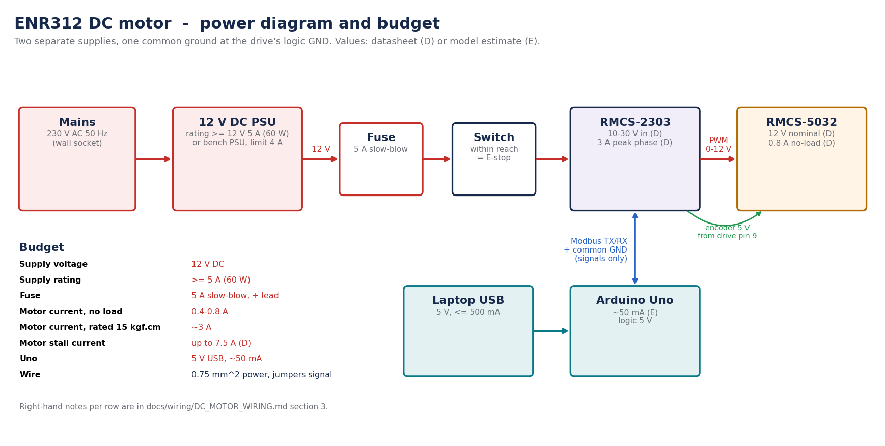

# DC motor — wiring and electrical guidelines

Hardware: Arduino Uno, Robokits **RMCS-2303** drive, Robokits **RMCS-5032** motor (the pair
supplied together), a Pro-Range 11.1 V Li-ion 3S2P battery (12.6 V full, 4400 mAh, 2C). Firmware: `firmware/motor_controller/`.
Status: **verified on the lab rig 2026-10-11** (20 runs, speed and position, correct direction).
The lab motor's cable does **not** use the datasheet colours; the table gives both. Final fix of the
direction: the two thin motor leads swapped at pins 14/15 (photo 13:08).

## 1. Pin plan

| Arduino Uno | Connects to | Why |
|---|---|---|
| **D8** (AltSoftSerial RX) | drive **TXD, pin 3** | Modbus replies from the drive |
| **D9** (AltSoftSerial TX) | drive **RXD, pin 2** | Modbus commands to the drive |
| **GND** | drive **GND, pin 1** | common logic reference — mandatory |
| **D4** | STOP push-button (normally open) → GND | hardware E-stop request (internal pull-up) |
| D13 | on-board LED | lit while the loop runs |
| USB | laptop | power for the Uno + MATLAB link (115200 baud) |

**Deviation from the vendor wiring (D2/D3):** the vendor example uses SoftwareSerial on D2/D3.
SoftwareSerial switches interrupts off for ~1 ms per byte, which corrupts commands from MATLAB
arriving at 115200 baud — including STOP. AltSoftSerial keeps interrupts on but is fixed to D8/D9
on the Uno. (D10 cannot be used for PWM while AltSoftSerial is active.)

| Drive pin | Function | **Lab motor cable (verified)** | RMCS-5032 datasheet colour |
|---|---|---|---|
| 8 GND | encoder GND | **Green** | Black |
| 9 +5 V | encoder VCC | **Blue** | Brown |
| 10 ENC_B | encoder B | **Yellow** | Orange |
| 11 ENC_A | encoder A | **White** | Red |
| 14 Motor− | motor lead | **Black (thin)** | Yellow |
| 15 Motor+ | motor lead | **Red (thin)** | Green |
| 16 VDD | supply + (11.1 V Li-ion battery) | thick red | — |
| 17 GND | supply − | thick black | — |

If a different motor or cable is used: wire encoder +5 V/GND first, then A/B, then the motor leads;
if the first run reports `runaway: wrong way`, swap **one** pair only (the two motor leads at
14/15, or A/B at 10/11), never both.

**Correction 2026-10-11 (conflict C-M3).** The drive manual's p.5 diagram is drawn for a
*generic* Rhino motor (red = ENC_B, orange = ENC_A). The **RMCS-5032's own sheet** (SRC-003) says
**red = EncA, orange = EncB**, and the actual part's datasheet wins. The first version of this
guide followed the drive manual; on the rig that crossed A/B and the drive's loops ran away
(`docs/safety/INCIDENT_2026-10-11.md`). The lab's cable then turned out to use neither scheme
(green/blue/yellow/white encoder, thin red/black motor leads); the table above is what works on the rig.
**Wire by pin number on the drive silkscreen, never by the row alignment of the manual's p.5
tables** (conflict C-M4).

## 2. Diagram

```
                 USB (laptop)
                     |
              +-------------+                      +------------------------------+
              | Arduino Uno |                      |        RMCS-2303 drive       |
              |          D9 |-------------------->| 2 RXD                        |
              |          D8 |<--------------------| 3 TXD                        |
              |         GND |---------------------| 1 GND                        |
              |          D4 |---[STOP]---GND       |                              |
              +-------------+                      | 8 GND  ---- green  ---+      |
                                                    | 9 +5V  ---- blue   ---+      |
   11.1 V battery (+) - fuse 5 A T --- switch -----| 16 VDD                |      |
                  (-) ------------------------------| 17 GND        encoder|  RMCS-5032
                                                    | 10 ENC_B --- yellow---+  motor
                                                    | 11 ENC_A --- white ---+  (1:100)
                                                    | 14 M-   ---- black (thin)
                                                    | 15 M+   ---- red (thin)  
                                                    | lab drive answers as ID 7  
                                                    +------------------------------+
```

## 3. Power and current requirements



Circuit diagram: [`figures/dc_motor_circuit.png`](figures/dc_motor_circuit.png) (SVG alongside; regenerate with
`python3 scripts/reports/draw_dc_motor_diagrams.py`).

| Item | Requirement | Basis |
|---|---|---|
| Supply voltage | **12 V DC** (11–13 V) | Motor nominal 12 V (SRC-003). Drive accepts 10–30 V (SRC-002 p.4), but 24 V lets it over-speed the motor (C-M6). |
| Supply capacity | **≥ 5 A (60 W)** adapter, or a bench PSU at 12.0 V with **current limit 4 A** | Drive limits phase current to 3 A peak (SRC-002 p.4) → ≤ 36 W; margin for start-up and drive electronics |
| Fuse | **5 A slow-blow (T)** in the + lead | Protects the 0.75 mm² leads. The drive's product page calls it a "10 A" drive while the manual says 3 A peak (C-M7), so do not rely on the drive's limit for wire protection |
| Motor current, free running | 0.4–0.8 A | 0.8 A at full speed (SRC-003); model ≈ 0.45 A at 100 rpm output (ESTIMATED) |
| Motor current at rated load (15 kgf·cm) | ≈ 3 A — **the drive's limit** | ESTIMATED from the datasheet torque constant; usable torque through this drive ≈ 17 kgf·cm |
| Motor stall current | up to 7.5 A (SRC-003) | not reachable through the drive; never hold the shaft at full command |
| Uno | 5 V from USB, ≈ 50 mA | never connected to the 12 V rail |
| Encoder | 5 V from drive pin 9 (tens of mA, UNVERIFIED) | |
| Power wiring | 0.75 mm² (18 AWG), short | supply ↔ drive pins 16/17 and drive ↔ motor pins 14/15 |
| Signal wiring | jumper wires < 30 cm, away from the motor leads | D8, D9, GND |

Grounding: the Uno's GND joins the drive at **pin 1 only**. That is the single common
reference for the UART. Do not run a second ground wire from the Uno to the supply's 0 V.

Drive logic level: the vendor wires the drive directly to a 5 V Uno. If you have a
multimeter, measure drive pin 3 (TXD) to pin 1 with the Uno disconnected and the drive
powered: it should idle between 3 and 5.5 V (OI-M11).

### 3a. The lab's actual supply: a 3S2P Li-ion battery, no switch

The rig is powered from a **Pro-Range INR18650 Li-ion pack, 3S2P: 11.1 V nominal, 12.6 V full,
4400 mAh, 2C (8.8 A continuous), with a built-in BMS** (owner, 2026-10-25; seller listing
SRC-016), and there is **no power switch**: the battery is live the moment its connector is
plugged in. Consequences:

- **The battery connector is the emergency stop.** Plug it in **last**, keep it within reach,
  and pull it to stop everything. Nothing else may sit between you and that connector.
- **Fuse is mandatory.** A lithium pack can deliver tens of amps into a short. Put the 5 A
  slow-blow fuse (or an inline blade fuse) in the + lead **at the battery end**.
- **Only the drive takes battery power** (pins 16/17). The Uno stays on USB. Do not connect the
  battery to the Uno's VIN or 5 V.
- **Under-voltage:** the drive needs ≥ 10 V (SRC-002), more than the pack's BMS cut-off (about
  9 V): the drive gives up first. Below ~10.5 V (3.5 V/cell) the pack is nearly empty: stop and
  recharge (3S Li-ion charger, 12.6 V CC/CV) rather than run near the drive's limit. Never store
  a lithium pack discharged.
- **Speed:** the free-running maximum scales with the voltage: about 189 rpm full, 166.5 rpm at
  11.1 V, 150 rpm at 10 V. The rig's full-voltage runaways measured a median of 166.8 rpm. Keep
  setpoints ≤ 150 rpm (a pack below ~10 V cannot reach 150). The physics panel's **battery charge**
  field sets the voltage from the state of charge.
- Power-up order without a switch: wire everything → Uno on USB → firmware connected in MATLAB
  → **plug the battery in last**. Power-down: **unplug the battery first**, then USB.
- **Never leave the battery connected while the Uno has no USB power.** The drive's TXD line
  (5 V idle) then back-powers the Uno through pin D8; the half-powered processor can lock up and
  stay silent after USB returns (observed 2026-10-11 12:13: port open, no `$HELLO`). Recovery:
  battery out → USB out 5 s → USB in → flash/connect → battery in.
- Plugging the battery in can reset the Uno (connector bounce through the shared ground,
  observed twice). Harmless: the firmware boots with the drive stopped; press **Drive check**
  or **Start** and it finds the drive again. A switch or anti-spark connector removes this.

## 4. Drive settings

| Setting | Value | How |
|---|---|---|
| Slave ID | **7 on the lab's drive** (found 2026-10-11); firmware scans 11, 7, 1–6 | as delivered — do not change |
| Lines per rotation (reg 10) | **13** | firmware writes it at boot if different (RAM only, not saved to EEPROM) |
| Mode | digital speed (Mode 1) | firmware |
| UART | 9600 8N1 | fixed |

## 5. Flash and first run (step by step)

**A. Flash (Uno only, drive unpowered)**

1. Plug the Uno into the laptop. Check it appears:
   `scripts/setup/acli board list` → a line with `/dev/ttyACM0 … arduino:avr:uno`.
2. Flash:
   ```bash
   cd ~/Projects/rhino-rmcs-2303-dc-servo-control
   scripts/setup/upload motor            # auto-detects the Uno; or: scripts/setup/upload motor /dev/ttyACM0
   ```
   Expect "Sketch uses … bytes" and an avrdude "bytes written / verified" message.
3. Serial Monitor check (optional): Arduino IDE (`~/Applications/arduino-ide_2.3.10_Linux_64bit.AppImage`)
   → Tools → Serial Monitor, **115200 baud, newline**. With no drive powered you should see
   `# no RMCS-2303 answered …` then `$HELLO,1,rhino_servo_lab,<rev>,0*..`. **Close the Serial Monitor
   before connecting MATLAB** (only one program may hold the port).

**B. Wire (everything unpowered)** per section 1 and the circuit diagram. Photograph it.
Motor clamped; output shaft free (a tape flag on it to see rotation).

**C. Power the drive**: switch on the 12 V. The drive's LED should come on; nothing should move.

**D. MATLAB**

1. `setup` (or `rhino_servo_lab`). Plug in the Uno: the app offers **Flash + connect** or
   **Connect**. The top bar then shows `RIG <port>` and `fw <rev> · drive id 7`, the state READY.
   If it says "NO DRIVE answered": check 12 V, D8↔pin 3, D9↔pin 2, GND↔pin 1, then **DRIVE CHECK**.
2. **DRIVE CHECK** (reads the RMCS-2303 registers): mode, gains, LPR (must read **13**),
   acceleration, speed, and the measured loop time. It is also written to the session log.
3. Mission **M1 · Open loop**, preset "Speed steps, open loop" or LAB "speed open loop, 40 rpm",
   **RUN ON RIG**. The shaft turns; the plot shows the measured speed (cyan) over the grey
   simulation of the same settings; the 3-D disc turns with the measured angle.
4. **STOP** (or ABORT, Esc, Space): motor power off. Then test the **D4 button** and the battery switch.
5. Watchdog: during a run, close the app window. The motor must stop within ~1 s.
6. Direction: with a positive speed command the measured speed must be positive. If the app reports
   `runaway: wrong way`, swap ONE pair (thin motor leads at 14/15, or yellow/white at 10/11),
   then **CLEAR FAULT**.
7. **Live driving:** mission LAB, **RUN ON RIG**, then type a value under LIVE SETPOINT (or ±10):
   the new rpm (−150 … +150, negative = reverse) goes to the motor at once.
8. **Course experiments:** each mission's presets are the runs of its course experiment;
   "▶▶ all runs" plays the whole series. Every run is saved and listed under RUNS.

Tested end to end against the real firmware code and an emulated drive
(`matlab/tests/e2e/e2e_motor_mission_control.m`, 19/19 on 2026-10-23): connect, DRIVE CHECK,
live setpoint, automatic save, latched fault and CLEAR FAULT, a course experiment, ABORT.
On the rig: sessions of 2026-10-11 and 2026-10-23.

**If something is wrong**

| Symptom | Likely cause |
|---|---|
| upload: "permission denied" on /dev/ttyACM0 | user not in `dialout` (this laptop: it is) — log out/in |
| upload: "programmer is not responding" | Serial Monitor or MATLAB still holding the port; wrong board |
| no `$HELLO` in MATLAB | Serial Monitor open elsewhere; wrong firmware |
| HELLO says slave id 0 | drive unpowered, TX/RX swapped, GND missing |
| `MODBUS_TIMEOUT` flag during a run | loose D8/D9 wire, drive reset by supply dip |
| speed reads ~25× wrong | LPR not 13 (Drive check shows it) |
| motor runs the wrong way | expected sign issue C-M3: note it; swap motor leads only if the course needs a fixed direction |

## 6. Hazards

Geared output ~1.5 N·m at up to 180 rpm: it can trap fingers and fling loose parts. Keep hands
off while enabled. Do not stall the motor for long at full command (3 A continuous heats the
motor). Do not rewire while powered.
