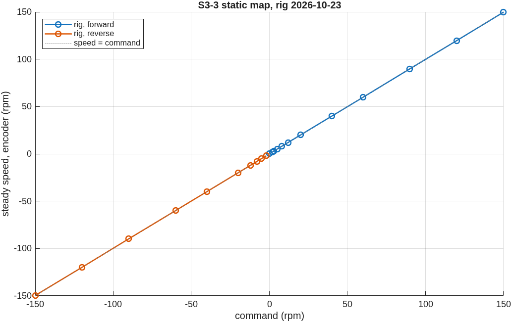
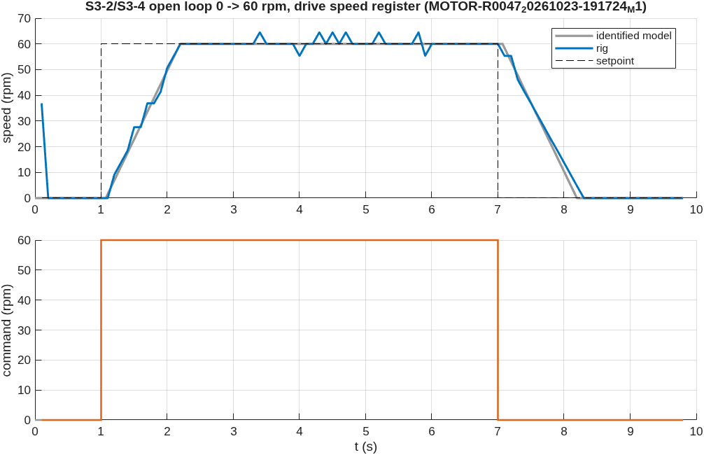
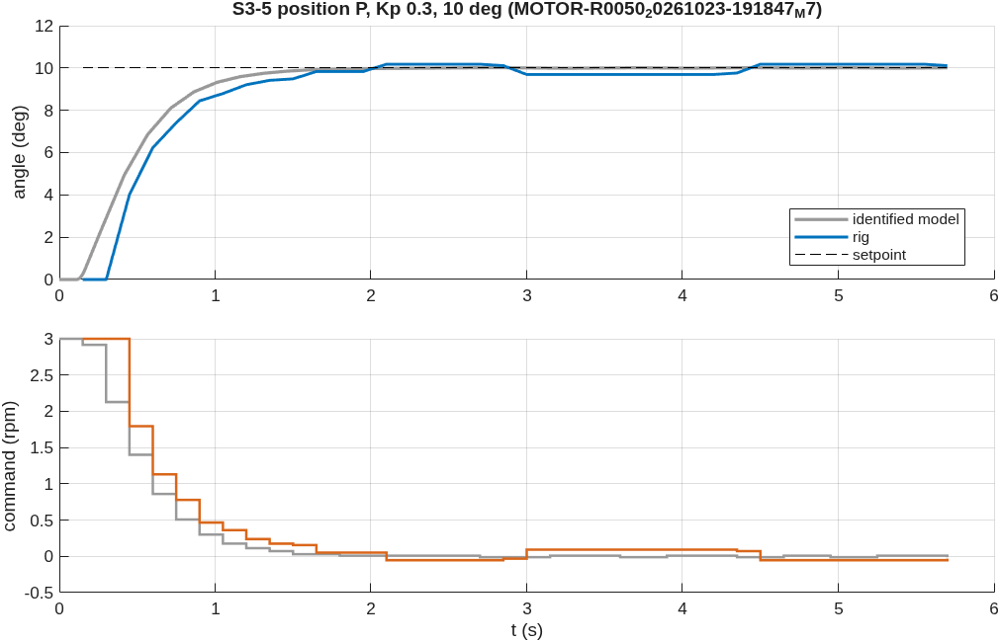
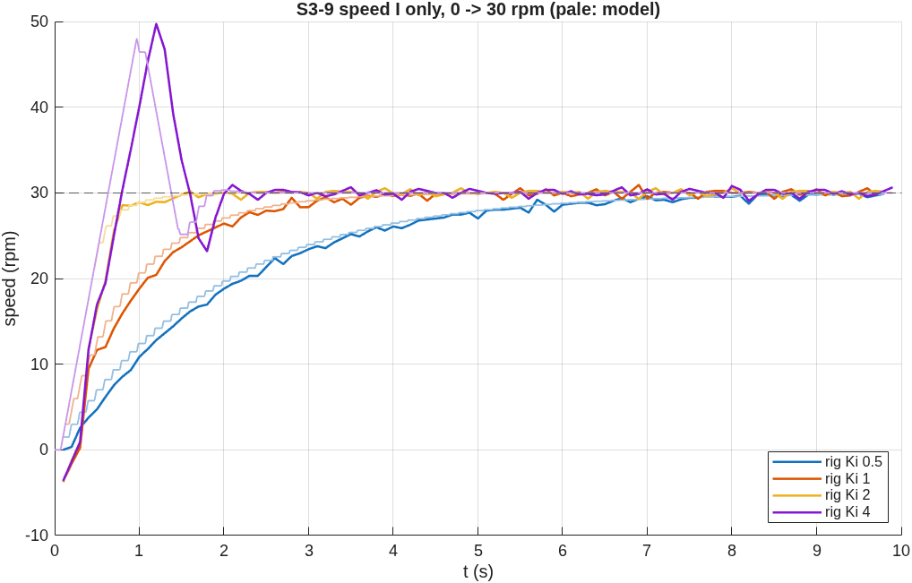
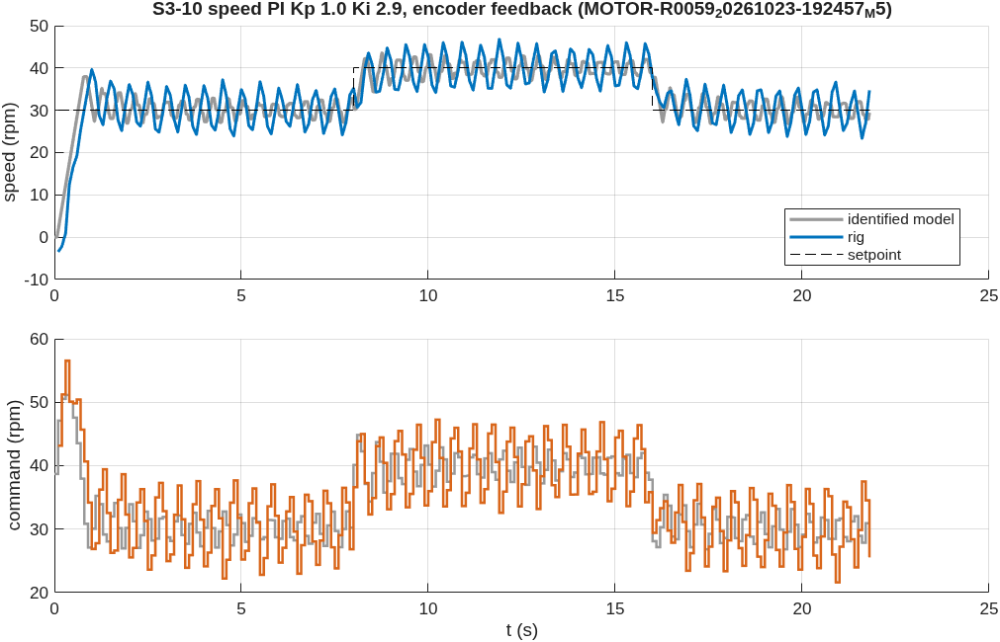
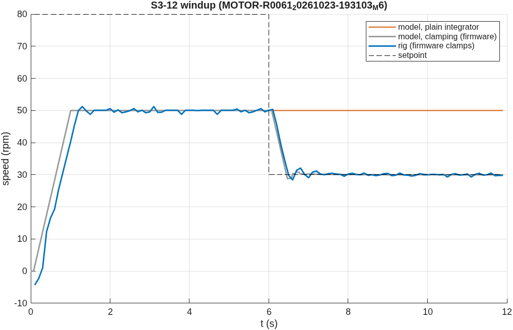

# DC motor: rig session 2026-10-23

Generated by `matlab/scripts/motor_session_report.m` from `data/raw/dc_motor` (38 runs from 18:50 on). Grey in every figure is the identified model (fitted on the 2026-10-11 open-loop runs only) running the same settings, so each comparison is a prediction. Units: output-shaft rpm and degrees.

## S3-3 Static map: steady speed against command
Commands 1 to 150 rpm held 3 s each, both directions, speed from encoder counts (0.115 rpm resolution; a step is listed when its last second is steady). **Dead zone: none**: the smallest command listed, 2 rpm, gives 2.04 rpm. **Gain 0.997** (forward) and 0.998 (reverse), top speed 149.7 rpm at the 150 rpm command: the drive closes its own speed loop, so the "actuator" is linear up to the command limit. Saturation (161-170 rpm at 11.2 V, measured 2026-10-11) was not reached.

| command (rpm) | steady speed (rpm) |
|---:|---:|
| 0 | 0.05 |
| 2 | 2.04 |
| 3 | 3.04 |
| 5 | 5.05 |
| 8 | 8.02 |
| 12 | 12.01 |
| 20 | 19.96 |
| 40 | 39.88 |
| 60 | 59.78 |
| 90 | 89.86 |
| 120 | 119.67 |
| 150 | 149.72 |
| -150 | -149.72 |
| -120 | -119.89 |
| -90 | -89.74 |
| -60 | -59.93 |
| -40 | -39.92 |
| -20 | -19.99 |
| -12 | -12.03 |
| -8 | -8.02 |
| -5 | -5.04 |
| -2 | -2.07 |

## S3-2 / S3-4 Open-loop step 0 -> 60 rpm
Drive-register feedback (run 1): rise 10-90 % **0.90 s** (model 0.80 s), mean slope 53.3 rpm/s (model ramp 53.4), gain 1.000, RMSE rig vs model 4.12 rpm (the register moves in 4.6 rpm steps). The step response is the drive's acceleration ramp, not a first-order lag.

**Encoder-feedback run (run 2): not obtained.** It was started 3 time(s) in this session and each time the firmware cut motor power (see "Safety events").

## S3-5 Position P: final error of 10 deg moves
| Kp | final error, rig (deg) | model (deg) | overshoot rig (%) | settling rig (s) |
|---:|---:|---:|---:|---:|
| 0.1 | -0.114 | 0.094 | 2.5 | 7.65 |
| 0.3 | -0.168 | 0.005 | 1.8 | 4.35 |
| 1.0 | -0.107 | 0.039 | 62.0 | not settled |

One encoder count is 0.069 deg. P alone reaches a 10 deg target to within a few counts at every gain: the drive's own loop removes the motor's dead zone, so even a 0.1 rpm command turns the shaft (S3-11).

## S3-9 Speed I only: damping against Ki
Theory (first-order plant K 1, tau 0.72 s): zeta = 1 / (2 sqrt(tau K Ki)), overshoot exp(-pi zeta / sqrt(1 - zeta^2)).

| Ki | zeta | overshoot theory (%) | model (%) | rig (%) | rise rig (s) |
|---:|---:|---:|---:|---:|---:|
| 0.5 | 0.83 | 0.9 | 0.0 | 0.0 | 4.10 |
| 1.0 | 0.59 | 10.1 | 0.0 | 3.1 | 1.80 |
| 2.0 | 0.42 | 23.7 | 0.0 | 1.8 | 0.40 |
| 4.0 | 0.29 | 38.0 | 55.0 | 65.8 | 0.40 |

More Ki, less damping, as the theory says; the identified model (with the 70 ms latency and the drive ramp) tracks the rig more closely than the delay-free formula.

## S3-10 Speed PI designed for zeta 0.7 (Kp 1.0, Ki 2.9)
First step 0 -> 30 rpm: overshoot **32.3 %** on the rig, 25.8 % in the model; the textbook design predicted 4.6 %. After it the loop does not settle: it holds a **limit cycle of +/- 6.7 rpm at 30 rpm and +/- 5.9 rpm at 40 rpm** (model RMSE 4.53 rpm, the model shows the same cycle). The design ignored the 70 ms Modbus latency and the 100 ms sampling; with them, Kp = 1.0 on encoder speed leaves too little phase margin. A design for this rig must include the delay (or use a lower Kp: the hand-tuned Kp 0.3, Ki 1.5 settles).

## S3-12 Saturation and windup (command limited to 50 rpm, 80 asked, then 30)
The output sits at the 50 rpm limit for 5.7 s while 80 is asked. When the setpoint drops to 30 rpm, the rig is back within 5 % in **0.5 s** (model with clamping 0.5 s). The same model with a plain integrator **does not get back within the remaining 6 s**: that difference is the windup the firmware's clamping prevents.

## Safety events
The firmware cut motor power 4 time(s) in the recorded runs:

| run | experiment | at t (s) | command (rpm) | measured (rpm) | reason |
|---|---|---:|---:|---:|---|
| MOTOR-R0048_20261023-191737_M1 | S3-2/S3-4 run 2 | 0.2 | 0.0 | -168.2 | runaway: too fast - check encoder and LPR |
| MOTOR-R0046_20261023-191408_M2 | S3-3 run 2 | 38.1 | 0.0 | -147.3 | runaway: too fast - check encoder and LPR |
| MOTOR-R0040_20261023-190640_M1 | S3-2/S3-4 run 2 | 0.2 | 0.0 | -166.5 | runaway: too fast - check encoder and LPR |
| MOTOR-R0035_20261023-190403_M1 | S3-2/S3-4 run 2 | 0.2 | 0.0 | -165.9 | runaway: too fast - check encoder and LPR |

A stop in the first 0.3 s of a run is the reverse runaway at enable (OI-M12): the motor at full voltage backwards while 0 or a small speed was asked. Its pattern over every session, and the firmware fix (HOME at every RUN, firmware e60d046 and later), are in `results/reports/dc_motor/2026-10-24/ANALYSIS.md` section 1 (`motor_rig_analysis`). A later stop while the command is falling can be a false trip of the guard during the drive's ramp-down.

