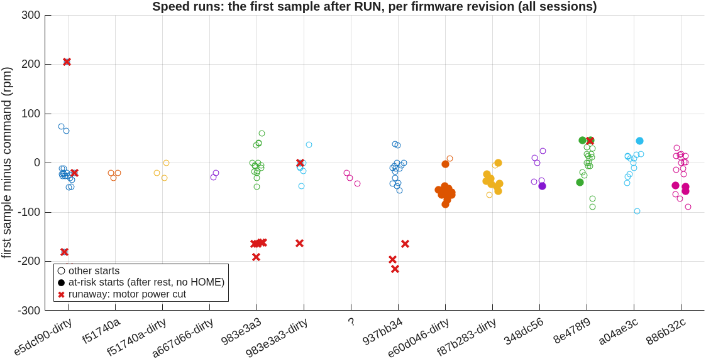
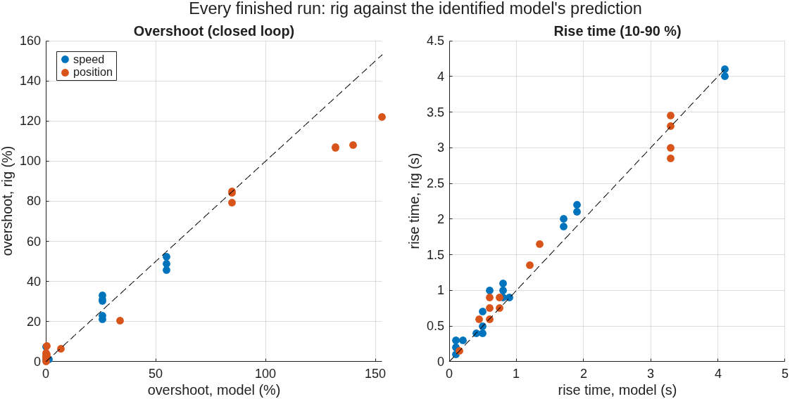
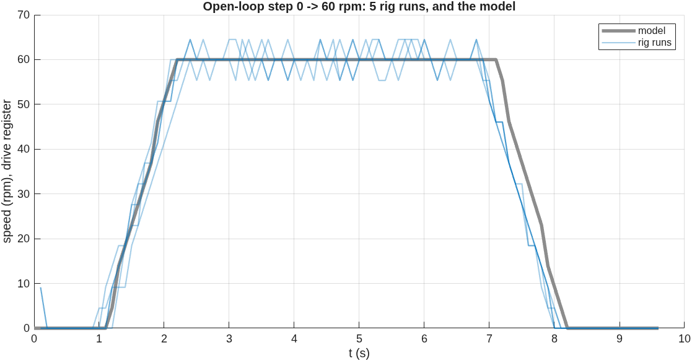

# DC motor: rig against model, 2026-10-25

Generated by `matlab/scripts/motor_rig_analysis.m` from `data/raw/dc_motor`: 81 runs, 79 finished runs scored. Grey (model) is `identifiedSim` with `rigModel` (fitted on 2026-10-11 only) running each run's own settings and profile, so every comparison is a prediction. Per-run numbers: [`analysis_runs.csv`](analysis_runs.csv).

## 1. Reverse runaway at run start (OI-M12) and the firmware fix
Counted from every session log (`results/evidence/logs/hw_session_*.log`), which also holds the runs the app did not save. A start is **at risk** when it is a speed run (drive or encoder feedback) that follows a run which ended with the motor at rest under a 0 command, with no HOME sent in between. Firmware `e60d046` and later write HOME at every RUN itself; `f87b283` also waits 150 ms after it before enabling the drive.

| firmware | sessions | runs | at-risk starts | runaway stops at those | other runaway stops | first sample at risk (rpm, median) | jerk at risk (counts, median) |
|---|---:|---:|---:|---:|---:|---:|---:|
| `e5dcf90-dirty` | 8 | 32 | 3 | **3** | 3 | - | - |
| `f51740a` | 1 | 3 | 0 | **0** | 0 | - | - |
| `f51740a-dirty` | 1 | 3 | 0 | **0** | 0 | - | - |
| `a667d66-dirty` | 1 | 2 | 0 | **0** | 0 | - | - |
| `983e3a3` | 1 | 23 | 5 | **5** | 0 | - | - |
| `983e3a3-dirty` | 1 | 12 | 1 | **1** | 1 | - | - |
| `?` | 2 | 4 | 0 | **0** | 0 | - | - |
| `937bb34` | 1 | 27 | 3 | **3** | 0 | - | - |
| `e60d046-dirty` | 1 | 14 | 13 | **0** | 0 | -52.8 | 43.0 |
| `f87b283-dirty` | 1 | 10 | 8 | **0** | 0 | -34.6 | 27.0 |
| `348dc56` | 1 | 9 | 1 | **0** | 0 | -46.7 | 24.0 |
| `8e478f9` | 2 | 27 | 3 | **0** | 1 | 45.9 | 24.0 |
| `a04ae3c` | 1 | 18 | 1 | **0** | 0 | 45.1 | 18.0 |
| `886b32c` | 1 | 27 | 3 | **0** | 0 | -36.9 | 27.0 |

Before the fix: **12 of 12** at-risk starts ran away. After it: **0 of 29**. Every runaway ran the motor backwards at full voltage within 0.1 s (the drive's 53 rpm/s ramp was bypassed), and the guard cut motor power within 0.2 s every time. The cause inside the drive is UNVERIFIED; the fix rests on this record.

What remains at enable: the first sample reads tens of rpm backwards, mostly because the HOME resets the count the speed is computed from; the encoder shows a real jerk (largest count excursion in the first 0.5 s, last column; 1 count = 0.069 deg). It never came near the guard's limits.

## 2. The datasheet physics against the runaways
Each runaway is, by accident, a full-voltage test: the drive applied the whole supply to the motor (the 2026-10-11 ones came from the reversed encoder wiring, positive feedback, the later ones from OI-M12). Largest speed read in the first 0.3 s of those 14 runs: median **166.8 rpm**, range 165.9 to 175.3 (the drive register reads in 4.6 rpm steps). The datasheet model (`servolab.motor.physics`: 180 rpm at 12 V, 0.8 A no-load, 7.5 A stall, 11.1 V battery) predicts **166.5 rpm** free speed at the output shaft, -0.2 % from the median. The battery voltage was not logged, so this agreement is within the voltage uncertainty, not a proof.

## 3. How well the model predicts the rig
RMSE between the rig's measurement and the model's measurement at the same controller instants, over the whole run.

| loop | controller | runs | RMSE median | RMSE max | rise rig / model (s, median) | overshoot rig / model (%, median) |
|---|---|---:|---:|---:|---:|---:|
| position | I | 4 | 5.97 deg | 6.96 deg | 1.35 / 1.20 | 107.4 / 135.8 |
| position | P | 15 | 0.77 deg | 26.24 deg | 0.90 / 0.75 | 3.1 / 0.0 |
| position | PI | 5 | 3.60 deg | 3.72 deg | 0.75 / 0.60 | 6.5 / 7.0 |
| speed (drive) | I | 3 | 3.91 rpm | 4.03 rpm | 2.00 / 1.70 | 7.5 / 0.0 |
| speed (drive) | OL | 7 | 4.32 rpm | 5.71 rpm | 1.00 / 0.80 | 7.5 / 0.0 |
| speed (drive) | P | 11 | 4.50 rpm | 5.40 rpm | - / - | 0.0 / 0.0 |
| speed (drive) | PI | 2 | 4.38 rpm | 5.29 rpm | 1.05 / 0.70 | 4.4 / 0.8 |
| speed (encoder) | I | 12 | 1.60 rpm | 3.14 rpm | 1.55 / 1.25 | 2.0 / 0.0 |
| speed (encoder) | OL | 10 | 5.04 rpm | 7.55 rpm | 0.30 / 0.10 | 67.3 / 3.8 |
| speed (encoder) | PI | 10 | 3.96 rpm | 4.89 rpm | 0.50 / 0.50 | 10.6 / 12.9 |

Relative to the largest setpoint of each run, the median RMSE is **6.3 %** (worst 22.7 %, `MOTOR-R0146_M7`). Part of every speed RMSE is quantisation: the drive register moves in 4.6 rpm steps and encoder speed in 0.115 rpm steps at Ts 0.1 s. The same quantisation makes the open-loop "overshoot" of 7.5 % on the register: one step above 60 rpm.

## 4. Repeatability: the same run, again and again
Each row: one run of one experiment repeated across the sessions (FINISHED runs only). The static map is in the session report; its "overshoot" between 1 rpm stairs means nothing.

| experiment | run | n | rise (s) mean ± sd | overshoot (%) mean ± sd | e_ss mean ± sd | RMSE vs model mean |
|---|---:|---:|---:|---:|---:|---:|
| Open-loop step 0 -> 60 rpm | 1 | 5 | 0.98 ± 0.04 | 7.5 ± 0.0 | -0.37 ± 0.38 | 4.06 |
| Open-loop step 0 -> 60 rpm | 2 | 3 | 0.90 ± 0.00 | 2.1 ± 0.8 | 0.10 ± 0.08 | 7.17 |
| Position I only (Ki 0.1) | 1 | 4 | 1.35 ± 0.00 | 110.8 ± 7.4 | -15.11 ± 13.87 | 6.16 |
| Position P final error on 10 deg moves (Kp 0.1 / 0.3 / 1.0) | 1 | 5 | 3.12 ± 0.25 | 2.9 ± 1.1 | -0.05 ± 0.16 | 0.36 |
| Position P final error on 10 deg moves (Kp 0.1 / 0.3 / 1.0) | 2 | 3 | 0.80 ± 0.09 | 4.8 ± 2.9 | -0.18 ± 0.12 | 0.68 |
| Position P final error on 10 deg moves (Kp 0.1 / 0.3 / 1.0) | 3 | 3 | 0.15 ± 0.00 | 82.8 ± 3.0 | 0.34 ± 0.22 | 2.04 |
| Position PI (Kp 0.3, Ki 0.03) | 1 | 5 | 0.72 ± 0.07 | 6.5 ± 0.1 | -2.74 ± 0.11 | 3.62 |
| Speed I only (Ki 1.0) | 1 | 3 | 1.97 ± 0.06 | 7.5 ± 0.0 | 0.10 ± 0.16 | 3.80 |
| Speed I only, Ki sweep 0.5 / 1 / 2 / 4 | 1 | 3 | 4.07 ± 0.06 | 0.6 ± 0.0 | 0.35 ± 0.02 | 0.99 |
| Speed I only, Ki sweep 0.5 / 1 / 2 / 4 | 2 | 3 | 2.17 ± 0.06 | 1.8 ± 0.4 | 0.01 ± 0.04 | 0.83 |
| Speed I only, Ki sweep 0.5 / 1 / 2 / 4 | 3 | 3 | 0.93 ± 0.06 | 2.8 ± 0.9 | 0.01 ± 0.01 | 2.19 |
| Speed I only, Ki sweep 0.5 / 1 / 2 / 4 | 4 | 3 | 0.70 ± 0.00 | 49.0 ± 3.3 | -0.01 ± 0.03 | 3.04 |
| Speed P gain sweep (Kp 0.2 / 0.5 / 0.8) | 1 | 5 | - ± - | 0.0 ± 0.0 | 50.09 ± 0.33 | 2.94 |
| Speed P gain sweep (Kp 0.2 / 0.5 / 0.8) | 2 | 3 | - ± - | 0.0 ± 0.0 | 39.77 ± 0.16 | 5.17 |
| Speed P gain sweep (Kp 0.2 / 0.5 / 0.8) | 3 | 3 | - ± - | 0.0 ± 0.0 | 33.35 ± 0.60 | 4.70 |
| Speed PI designed for zeta 0.7 on a first-order model (Kp 1.0, Ki 2.9) | 1 | 5 | 0.54 ± 0.15 | 27.7 ± 5.4 | 0.23 ± 0.19 | 4.69 |
| Saturation and windup | 1 | 5 | - ± - | 0.0 ± 0.0 | 30.10 ± 0.05 | 2.98 |

## 5. Refit of the model on this session's open-loop steps
Fitted on 8 open-loop steps of 2026-10-25 (both feedback paths):

| parameter | rigModel (2026-10-11) | refit (2026-10-25) |
|---|---:|---:|
| gain K | 1.000 | 1.003 |
| ramp (output rpm/s) | 53.4 | 53.3 |
| tau (s) | 0.001 | 0.000 |
| dead time (s) | 0.000 | 0.000 |
| fit RMSE (rpm) | 2.34 | 1.97 |

The rig has not drifted in 13 days if the refit stays within the run-to-run spread of section 3.

## 6. Simulink against the MATLAB model
`servo_identified.slx` run with the same settings as `identifiedSim`, one run of each kind:

| run | loop | controller | max difference Simulink - MATLAB | RMSE Simulink vs rig | RMSE MATLAB vs rig |
|---|---|---|---:|---:|---:|
| `MOTOR-R0192_M8` | position | I | 0.000 | 5.71 | 5.89 |
| `MOTOR-R0191_M7` | position | P | 0.000 | 26.24 | 26.24 |
| `MOTOR-R0193_M9` | position | PI | 0.000 | 3.66 | 3.63 |
| `MOTOR-R0180_M4` | speed (drive) | I | 0.000 | 3.46 | 3.46 |
| `MOTOR-R0170_M1` | speed (drive) | OL | 0.000 | 5.40 | 5.40 |
| `MOTOR-R0175_M3` | speed (drive) | P | 0.000 | 4.46 | 4.46 |
| `MOTOR-R0183_M5` | speed (drive) | PI | 0.000 | 5.29 | 5.29 |
| `MOTOR-R0179_M4` | speed (encoder) | I | 0.000 | 2.94 | 2.94 |
| `MOTOR-R0172_M2` | speed (encoder) | OL | 0.000 | 4.16 | 4.16 |
| `MOTOR-R0184_M6` | speed (encoder) | PI | 0.000 | 3.43 | 3.43 |

Compared at the controller samples. The two implementations of the same model (`identifiedSim` in MATLAB, the .slx in Simulink) give the listed difference; their RMSE against the rig differs only where the rig's samples fall between the model's.
